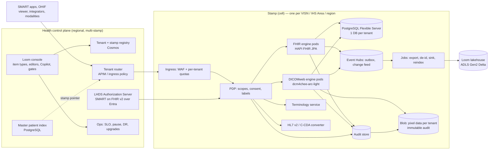

# LHDS — Architecture

Loom Health Data Services (LHDS) is a from-scratch, Azure-native health data
platform inside CSA Loom: FHIR R4 + DICOMweb + terminology + legacy conversion +
bulk export + de-identification + a continuous lakehouse sink, built only on
standard Azure services that exist in Azure Government, with proven open-source
protocol engines inside Loom-owned platform plumbing. It uses Azure Health Data
Services (AHDS) as a **model only** (`AHDS-MODEL-MAP.md`); AHDS itself is not
available in Azure Government (`AZURE-GOV-AVAILABILITY.md` row "Azure Health
Data Services") and LHDS never depends on it.

Decisions are recorded in `adr/` (ADR-001 .. ADR-018). This file is the map.

## 1. Shape in one picture

## 2. Components (and the wave that builds each)

| Component | Role | Built from | Wave |
|---|---|---|---|
| Health control plane | Tenant and stamp registry, routing map, stamp lifecycle (create, grow, drain, evacuate, pause), per-tenant quotas, global MPI, authorization server, ops surfaces | Loom console (Next.js BFF, Cosmos) + new `apps/loom-health-cp` service | W1 |
| Stamp | A self-contained deployment unit: AKS cluster, PostgreSQL Flexible Server, Blob accounts, Event Hubs, Key Vault, Log Analytics, private DNS, ingress | `platform/fiab/bicep/modules/health/stamp.bicep` (+ `tenant.bicep`) | W1 |
| FHIR service | FHIR R4 (US Core profiles), search, history, transactions, `$everything`, `$validate`, subscriptions (R4 backport / topic-based later) | **HAPI FHIR JPA** (Apache-2.0) — ADR-001; fallback Medplum (Apache-2.0) | W2 |
| DICOM service | DICOMweb STOW/QIDO/WADO-RS, UPS-RS, change feed, extended query tags, export, DICOM-to-FHIR `ImagingStudy` | **dcm4chee-arc-light** (MPL-1.1 / LGPL-2.1 use) — ADR-002; fallback Orthanc isolated (GPLv3 core, AGPLv3 plugins) or a Loom-built DICOMweb-on-Blob service modelled on the archived MIT microsoft/dicom-server | W3 |
| Terminology service | CodeSystem / ValueSet / ConceptMap, `$lookup`, `$validate-code`, `$expand`, `$translate`; bundled free vocabularies; customer-loaded SNOMED | HAPI FHIR terminology module (same engine) with LHDS loaders — ADR-013 | W4 |
| Conversion service | HL7 v2 (MLLP + REST), C-CDA, JSON templates -> FHIR; `$convert-data`; VistA / RPMS adapter specs | microsoft/FHIR-Converter (MIT, Liquid) — ADR-014 | W5 |
| Bulk Data | `$export` system / group / patient, `$import`, parallel range export from replicas | Engine `$export` + LHDS export workers — ADR-003 | W6 |
| De-identification | FHIR and DICOM de-id, text PHI detection, date shift, surrogates, Expert Determination hook | Tools-for-Health-Data-Anonymization + Presidio (MIT) — ADR-015 | W6 |
| Lakehouse sink | FHIR resources (flattened per type) + DICOM metadata -> Delta in the tenant's Loom lakehouse | LHDS sink workers (Spark-free: Delta via the existing Loom writer path or `delta-rs`) — ADR-016 | W6 |
| PDP | Scope, consent, security-label, break-glass decisions; redaction | OPA (Apache-2.0) with Rego bundles, or Loom's access-policy engine if latency allows — ADR-011 | W1 (scopes), W8 (consent) |
| Audit | `AuditEvent` per operation, immutable chain, SIEM | Engine interceptors + LHDS audit writer | W2, W8 |
| Viewer | OHIF (MIT) over DICOMweb with Loom auth | ADR-017 | W9 |
| MedTech / device ingest | Event Hubs / IoT Hub device messages -> `Observation` via mapping templates | LHDS mapper modelled on the (deprecated) AHDS MedTech grammar — ADR-018 | W10 |
| Loom product surfaces | Item types, editors, Copilot tools, gates, parity docs | `LOOM-INTEGRATION.md` | W9 |

## 3. Stamps (cell-based scale model)

### 3.1 What a stamp is
One region, one AKS cluster (private), one PostgreSQL Flexible Server (zone-
redundant HA where the region supports it, plus read replicas), one Blob
account set (per tenant: pixel data; per stamp: audit, export staging), one
Event Hubs namespace, one Key Vault (per-tenant keys), one Log Analytics
workspace, private DNS, egress firewall rules, and the engine Deployments. A
stamp is created, grown, drained, evacuated and paused by the control plane; it
has no knowledge of other stamps. Blast radius = the tenants on that stamp.

### 3.2 Why AKS and not Container Apps for the stamp
Azure Container Apps in Azure Government is in scope for FedRAMP High and DoD
IL2 only; AKS is in scope for IL5 (`research/azure-gov-availability.md`). The
operator's mandate is that IL5/DoD are configuration, not redesign, so the
stamp runs on AKS in every cloud (ADR-009). The existing Loom admin plane keeps
its Container Apps dispatcher (`container-platform.bicep`); LHDS does not change
it. The control-plane service (`apps/loom-health-cp`) is a Container App in
Commercial/GCC-High and an AKS Deployment at IL5. The `containerPlatform`
parameter exists, but every param file at `main` `b192f05ea` sets it to
`containerApps`, including `il5.bicepparam:121` (W0 receipt section 7). The IL5
AKS path is therefore new W1-3 work, not an existing setting, and flipping the
admin-plane-wide switch at IL5 would move all of Loom, not only LHDS.

### 3.3 Tenancy
A tenant = a health organisation boundary (a VISN's facilities, an IHS Area, a
Commercial health system) that owns patients, consent policy, keys and quotas.
A tenant maps to exactly one stamp at a time. Isolation per
`SECURITY-AND-COMPLIANCE.md` section 3: one PostgreSQL database per tenant on
the stamp (ADR-003), one Blob container per tenant, one key per tenant. A
tenant is represented in Loom as a workspace-scoped `health-tenant` item
(`LOOM-INTEGRATION.md`).

### 3.4 Routing
The router is stateless: `tenantId` (from the token's `tid`/app role, or from
the URL prefix `/{tenant}/fhir`, `/{tenant}/dicomweb`) -> stamp base URL, from a
cached registry snapshot with a short TTL and last-known-good on registry
outage. Implemented as an APIM policy (classic Premium tier, which is in scope
in Gov; v2 tiers are not — research) in front of the stamps, or the stamp
ingress itself for single-stamp deployments. ADR-006.

### 3.5 Cross-stamp patient lookup (MPI)
The control-plane MPI stores patient identity records (identifiers: ICN, MRN
per facility, SSN hash where the tenant allows, demographics hash) and stamp
pointers, never clinical data. Linking is **deterministic** on shared
enterprise identifiers in v1 (VA ICN, IHS HRN) with a reviewable candidate
queue for conflicts; probabilistic matching is explicitly **not** invented
without evidence — ADR-006 lists the evaluation path (e.g. OpenEMPI-class
tools or the engines' own patient-matching) as a W11+ decision (D11). A
`$match`-style operation on the control plane returns stamp pointers so a
client calls the right stamp; cross-stamp `$everything` is a control-plane
fan-out that is bounded, paged and audited.

### 3.6 Scaling
Vertical within a stamp (replicas, vCores, storage autogrow, node pools);
horizontal by adding stamps and moving tenants (evacuation, section 6 of
`OPERATIONS-AND-BCDR.md`). Capacity arithmetic in `CAPACITY-MODEL.md`
section 5-6: all VA ~18 class-M stamps (VISN-aligned), all IHS ~4.

### 3.7 Stamp sizing
Class S / M / L in `CAPACITY-MODEL.md` section 5; a stamp's class is a bicep
param; growing a class is an in-place vCore/storage change in a window.

### 3.8 Evacuation and DR
`OPERATIONS-AND-BCDR.md` sections 5-6.

## 4. Data architecture (summary of ADR-003, 004, 007, 008)

- **FHIR persistence**: HAPI JPA on PostgreSQL, one database per tenant, HAPI
  partition mode (`PARTITION_ID` in every table) enabled from day one for
  facility-level partitioning inside a tenant (it cannot be enabled later —
  research), `HFJ_SPIDX_*` index tables trimmed to the ADR-008 search set,
  read replicas for search and export, pgBouncer-style pooling per tenant.
  Document store and search-index hybrids were rejected for v1 (no managed
  OpenSearch in Azure Government; Azure AI Search is not a FHIR search engine);
  a self-hosted OpenSearch on AKS is the ADR-008 escape hatch for full-text.
- **DICOM**: pixel data in Blob (flat namespace, per-tenant container, CMK,
  versioning, lifecycle tiering), metadata and extended query tags in the
  stamp's PostgreSQL (dcm4chee schema, per-tenant database), study-level
  content hash recorded at STOW.
- **Async write path**: engines commit synchronously; a transactional outbox
  table in each tenant database records the change; an outbox relay publishes
  to Event Hubs (per tenant hub); consumers (sink, subscriptions, DICOMcast
  equivalent, audit index) are idempotent on `(resourceId, versionId)` /
  `(sopInstanceUid, sequence)`. "Exactly-once-ish" = at-least-once delivery
  plus idempotent consumers plus sequence gaps alerted.
- **Versioning / history / conditional ops / referential integrity**: engine-
  native (HAPI); the configured policies and their tests are in ADR-003.
- **Reindex**: HAPI `$reindex` per partition, throttled, run from a replica-
  backed worker; a search-parameter change is a versioned migration with a
  measured duration before it is applied to a VA-scale tenant.
- **Change feed**: DICOM change feed native to dcm4chee (audit/`UPS` events)
  exposed through an LHDS endpoint with the AHDS change-feed shape (`AHDS-
  MODEL-MAP.md` section 2); FHIR change feed = `_lastUpdated` + outbox events.

## 5. Identity, security, compliance

`SECURITY-AND-COMPLIANCE.md`. Key points: Entra per cloud; LHDS Authorization
Server issues SMART v2 tokens; PDP per stamp; per-tenant CMK; private-only
network; immutable audit with hash chain; consent + labels enforced at the PDP
on reads, exports and the sink; log scrubber + sentinel test.

## 6. Per-cloud status (the parity table every status report must copy)

| Capability | Commercial | GCC-High | IL5 | DoD | GCC |
|---|---|---|---|---|---|
| Stamp bicep (AKS, PG Flexible, Blob, EH, KV) | Supported-in-code (W1); receipt per wave | Supported-in-code; Actions receipt per wave | Supported-in-code only; `deploy-fiab-il5.yml` has no recorded run (`cloud-parity.md`) — **never exercised** | No param file / `boundary` enum lacks DoD (`main.bicep:20`) — **not deployable today**, tracked as D3 | Supported-in-code only, never exercised |
| Azure OpenAI-backed optional features | Yes | Yes (usgovarizona / usgovvirginia; research) | Config | Config | — |
| Front Door Premium edge | Yes | US Gov Arizona / Texas only (research) -> App Gateway WAF v2 in Virginia | App Gateway | App Gateway | — |
| Redis cache | Not used (Azure Cache for Redis stops new caches 2026-04 per research) -> in-cluster Valkey | same | same | same | — |
| Everything else | same code, same bicep, params differ | | | | |

Rows are updated with the run ids that exercise them; a boundary is listed as
exercised only with a deploy receipt (`cloud-parity.md`).

## 7. Relationship to the existing Loom estate

- Reuses: Loom console and BFF (`apps/fiab-console`), Cosmos control-plane
  store, item/editor framework, gate registry, Copilot tool registry, estate
  power (pause/resume), program budget, audit stream, cloud-endpoint resolution,
  image build pool, Trivy/cosign gates, Loom lakehouse (ADLS Gen2 Delta) and
  the Loom Unity / Trino / Iceberg federation for analytics.
- Adds: `apps/loom-health-cp`, `platform/fiab/bicep/modules/health/**`,
  `apps/fiab-console/lib/health/**`, item types and editors, Copilot tools,
  docs under `docs/fiab/health/**`.
- Never touches: Fabric (no Fabric dependency anywhere; Fabric "Healthcare data
  solutions" is a UX reference only), AHDS.

## 8. Non-functional requirements (binding)

Availability and latency targets: `OPERATIONS-AND-BCDR.md` section 1. Scale:
`CAPACITY-MODEL.md`. Security: `SECURITY-AND-COMPLIANCE.md`. Testability:
`TEST-STRATEGY.md`. Operability: a stamp is created, paused, resumed,
evacuated and destroyed by control-plane operations with receipts; no manual
`kubectl` step is a documented procedure.

## Related

`PRD.md`, `adr/`, `AHDS-MODEL-MAP.md`, `AZURE-GOV-AVAILABILITY.md`,
`CAPACITY-MODEL.md`, `LOOM-INTEGRATION.md`, `PRP.md`.
