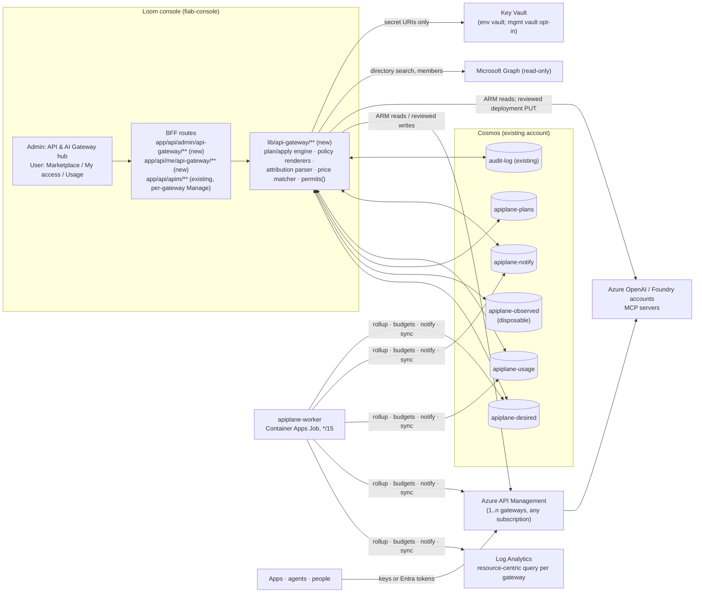

# Architecture — the API & AI Gateway Plane inside the Loom console

Evidence: repo paths at `origin/main` `b9decb4a8` (2026-10-28); Mosaic
behaviour from `research/mosaic-apim-sources.md`. New paths are marked
**(new)**.

## 1. Shape in one paragraph

The plane is a **control plane** that lives in the Loom console (Next.js BFF
routes + Cosmos + Fluent v9) and in one Container Apps Job. It stores desired
governance state, mirrors observed gateway state, produces deterministic plans,
applies them to Azure API Management only after a human review, and reads
gateway telemetry from Log Analytics. It is never in the request path:
callers → APIM → Foundry / MCP server, exactly as today. Everything Mosaic
runs as a Python API, two SPAs and five Entra registrations becomes Loom
routes, Loom pages, Loom's existing sign-in plus two runtime registrations.



## 2. Where it sits in the console

| Layer | Existing (measured) | New |
|---|---|---|
| Admin pages | `app/admin/api-management/page.tsx` (8 tabs, single gateway via `/api/marketplace/gate`) | `app/admin/api-gateway/**` (new): Overview · Gateways · Models · Pools · MCP servers · Entitlements · Cost centers · Analytics · Pricing · Settings (Environments, Connections, Findings, Runtime, Notifications). `/admin/api-management` becomes a redirect to the default gateway's Manage view; its eight panes (`lib/components/admin/apim-*-pane.tsx`, 9 files) are reused unchanged inside Gateways → [gateway] → Manage. Nav icon map: `lib/components/admin-shell.tsx:51`. |
| User pages | `app/marketplace`, `app/api-marketplace`, `app/governance/access-requests`, bell → `notificationsContainer` | Marketplace gains **Models** and **MCP servers** offering kinds; **My access** (connection details drawer, keys), **My requests**, **Usage & cost** as user-scoped pages under the marketplace; notification preferences page. No second portal. |
| BFF routes | `app/api/apim/{service,apis,operations,products,subscriptions,named-values,backends,gateways,instances,import,developer-portal}` (single instance), `app/api/access-requests` (`withApprovalAuthority`), `app/api/approval-policies`, `app/api/notifications`, `app/api/admin/finops/budgets`, `app/api/admin/chargeback` | `app/api/admin/api-gateway/**` (`withTenantAdmin`), `app/api/me/api-gateway/**` (`withSession`, caller-only, never a subject parameter), `app/api/apim/**` gain `?gateway=<id>` resolving through the registry instead of `LOOM_APIM_NAME` |
| Library | `lib/azure/apim-client.ts` (ARM), `lib/azure/foundry-client.ts` (`listDeployments:431`), `lib/azure/graph-identity-client.ts`, `lib/azure/graph-principals.ts`, `lib/azure/cloud-endpoints.ts`, `lib/azure/budgets-client.ts`, `lib/util/arm-counted-raw-fetch.ts`, `lib/gates/registry/*`, `lib/mcp/catalog.ts`, `lib/azure/mcp-client.ts` | `lib/api-gateway/**` (new): `registry/`, `observe/`, `plan/`, `policy/` (renderers), `shapes/` (operation sets), `entitlements/`, `telemetry/` (KQL, parser, rollup), `pricing/` (+ `model-prices.json`), `cost-centers/`, `budgets/`, `environments/`, `mcp/`, `pools/`, `connections/`, `notify/` |
| Cosmos | `lib/azure/cosmos-client.ts` lazy `createIfNotExists` (`:136-187` comments), e.g. `mcpServersContainer():1373`, `notificationsContainer():1640`, `auditLogContainer():1641` | five containers below, same lazy pattern plus a bicep declaration where the landing-zone Cosmos is bicep-managed (`modules/landing-zone/cosmos.bicep`) |
| Jobs | `modules/admin-plane/cost-anomaly-monitor-job.bicep`, `access-governance-sweeper-job.bicep`, `asset-reconciler-job.bicep` (Container Apps Jobs, Console UAMI) | `modules/admin-plane/apiplane-worker-job.bicep` (new), cron `*/15 * * * *`, image `loom-uat` (the image the existing jobs run), `command: ['node','e2e/run-apiplane-worker.mjs']`, calling the internal-token routes `app/api/internal/api-gateway/*` (new) exactly as `run-cost-anomaly.mjs` calls `app/api/internal/cost-anomaly` |
| Identity | `scripts/csa-loom/bootstrap-msal-app-reg.sh` (1,629 lines; already handles `appRoles`, `oauth2PermissionScopes`, `identifierUris`, `groupMembershipClaims`, admin consent); post-deploy workflow step "Provision MSAL app registration" | two registrations added to the same step: `loom-<env>-model-runtime`, `loom-<env>-model-client` (§ 6) |
| Gates | `lib/gates/registry/types.ts` (`FixitKind`: env-picker, resource-picker, role-grant, wizard, provision) | `lib/gates/registry/api-gateway.ts` (new): gateway role missing, Monitoring Reader missing, LLM logs unavailable in boundary, runtime consent withheld, mailbox not configured, cross-cloud vault absent |

## 3. Data model

All containers partitioned by `/tenantId` (Mosaic ADR 0002; Loom's
`tenantScopeId(session)` convention, see `app/api/access-requests/route.ts`
header). Every document carries `kind`, `tenantId`, `createdAt`, `updatedAt`,
and an `_etag`-guarded write path.

| Container (new) | Kinds | Notes |
|---|---|---|
| `apiplane-desired` | `gateway`, `modelEndpoint`, `mcpEndpoint`, `publication`, `mcpPublication`, `modelPool`, `modelApi`, `mcpServer`, `principal`, `entitlement`, `costCenter`, `costCenterSettings`, `budget`, `environmentCatalog`, `priceVersion`, `azureConnection`, `notificationPreference`, `planeSettings`, `lease` | Administrator-authored and audited. Document-level TTL enabled with default `-1` so settings never expire while leases can. Mosaic's audit outbox is replaced by Loom's existing `auditLogContainer` written in the same request with `kind: 'apiplane.<area>.<verb>'`. |
| `apiplane-observed` | `observedApi`, `observedOperation`, `observedProduct`, `observedSubscription`, `observedApimUser`, `observedApimGroup`, `observedBackend`, `observedNamedValue` (metadata, never value), `policyAnalysis` (digest + facets), `observedMcpServer`, `observedModelDeployment`, `observedMcpTool`, `syncState` | Disposable, rebuilt per sync with deterministic IDs; documents absent from a clean snapshot are swept; **a failed read exempts its type from the sweep** (Mosaic ADR 0004). |
| `apiplane-plans` | `publishPlan`, `publishRun`, `unpublishPlan`, `deploymentPlan`, `deploymentRun`, `writeLock` | Plans carry a SHA-256 digest over the semantic facets and the environment fingerprint; apply refuses a stale digest (`409 stalePlan`) or a missing plan (`409 planRequired`). |
| `apiplane-usage` | `usageFact` (day × gateway × grant link × caller, hourly breakdown by API, deployment, model, client app), `usageSummary` (day/month × gateway × dimension, sharded at 1,000 entries), `attributionRegistry`, `rollupState`, `budgetState` | TTL `LOOM_APIPLANE_USAGE_RETENTION_DAYS` (default 400, min 62) on daily facts and summaries; monthly summaries, registry and state kept. Figures are additive except peak minutes (max). |
| `apiplane-notify` | `notificationEvent`, `delivery`, `attempt`, `digest`, `checkpoint` | In-app inbox items go to the existing `notificationsContainer` (`{userId,title,body,severity,link}` shape at `app/api/notifications/route.ts:7`), so the bell keeps working unchanged. |

### Key entity shapes (abridged; full TypeScript types land in W1/W2)

```ts
// gateway — Mosaic ADR 0004
{ kind:'gateway', id, tenantId, displayName, resourceId, cloud:'AzureCloud'|'AzureUSGovernment',
  connectionId?: string,                // null = host identity (Console UAMI)
  managementMode:'observe'|'manage',    // writes only in 'manage'
  environment?: string,                 // catalog key or undefined (Unclassified)
  access:{ canRead, canWrite, missingRole?:{ roleDefinitionId, scope, azCommand }, checkedAt },
  capabilities:{ skuName, tier:'v2'|'classic'|'consumption'|'unknown', gatewayUrl, identity?:{principalId},
                 mcpServers:'available'|'unavailable'|'unknown', llmPolicies:'available'|'unavailable'|'unknown' },
  inventory:{ apis, products, subscriptions, backends, namedValues, mcpServers, lastSyncAt, partialTypes:string[] },
  ownedBy:'deploy'|'registered' }        // 'deploy' = Loom's own bicep-authored APIM, auto-registered

// entitlement — Mosaic ADR 0009 / 0011 / 0016 / 0022
{ kind:'entitlement', id /* deterministic: tenant+subject+resource+costCenter */, subject:{ kind:'user'|'application'|'securityGroup', principalId },
  resource:{ kind:'modelApi'|'poolModel'|'mcpServer'|'product'|'modelDeployment', id, scopeId },
  costCenterId, enabled:boolean, enforcement?:{ tokens?:{ perMinute?, quota?:{amount,window} }, requests?:{ perMinute?, quota? } },
  binding?:{ gatewayId, productId?, subscriptionId?, attributionKey?, attributionPerMember?, source:'inferred'|'manual'|'orchestrated' },
  applied?:{ keysEnabled, entraEnabled, snapshotVersion, at }, revoked?:{ reason, at } }

// publication — Mosaic ADR 0010 / 0012
{ kind:'publication', id, gatewayId, endpointId, deploymentName, apiShape:'azureOpenAi'|'foundryModels'|'anthropicMessages',
  names:{ backend, fragment:'loom-pub-<slug>', api, product, namedValue? }, governed:{ keys:boolean, entra:boolean, limits? },
  ownership:{ created:string[] /* resource ids this plane created, merged across applies */ }, appliedDigests?:{ apiPolicy, fragment },
  unpublishedAt?, environmentFingerprint }
```

## 4. The plan → apply → rollback engine (W2-1, Opus design pass)

Adopted from Mosaic ADR 0010/0011/0017/0024 with Loom naming.

1. **Plan** is a pure function of desired state + the latest observed
   snapshot + the environment catalog → an ordered list of steps
   (`create|update|delete|noop`, resource type, name, semantic facets) plus a
   digest. Planning never writes to Azure. The console renders steps and
   warnings (unclassified pairings, limits unavailable on this tier, consent
   not granted, diagnostics requirement for MCP).
2. **Apply** runs against one plan ID; refuses if the gateway is `observe`,
   the digest is stale, or another run holds the gateway write lock
   (`writeLock` lease in `apiplane-plans`). Steps execute in dependency order:
   named values → backends → backend pools → fragment → API → operations →
   API policy → product → product-API link → subscriptions/keys → deletes in
   reverse. Each step re-reads before writing; a resource the plan expected to
   create that now exists is **refused, not overwritten**. Long-running writes
   (fragment PUT, API PUT/DELETE) are polled via `Azure-AsyncOperation` /
   `Location` until terminal. Each step records created-vs-found.
3. **Rollback** on failure reverses completed steps and deletes only resources
   this run created. Rollback failures are reported with what remains; nothing
   reconciles orphans automatically (disclosed).
4. **Unpublish** is its own reviewed plan listing every enabled grant that
   stops working; it denies access before deleting the API (MCP: writes a
   deny policy first), records `unpublishedAt`, and leaves grants in the plane
   with revoked runtime state (`409 notPublished` on connection routes).
5. **Drift** is detected on re-plan (existence) and via stored digests of the
   API policy and fragment (content); never auto-repaired.
6. **Recovery**: an interrupted run keeps its lock; a recovery action requires
   the operator to confirm the worker has stopped, re-establishes deny, marks
   the run failed and releases the lock.

Every write goes through `lib/util/arm-counted-raw-fetch.ts` (`[arm-reads]`
accounting, #5074) and the existing `apim-client.ts` functions; new ARM
surfaces needed and **absent today**: policy fragments, MCP APIs
(`2025-09-01-preview`), diagnostics and loggers per API, backend pools and
circuit breakers (the client has `upsertBackend:1420` but no pool body), named
values with Key Vault identifiers (client accepts `ApimKeyVaultRef:1207`;
UI does not), subscription state transitions (route exists:
`subscriptions/[sid]`).

## 5. Policy fragment library (`lib/api-gateway/policy/`, ported from Mosaic)

Mosaic keeps enforcement in `mosaic-*` fragments included by a thin API
policy. Loom uses the prefix `loom-` and the same decomposition:

| Fragment | Sections | Contents |
|---|---|---|
| `loom-pub-<slug>` (model publication) | inbound | operation guard → credential intake (subscription key against the grant snapshot and/or `validate-azure-ad-token` for `api://<runtime>` with `Models.Invoke` / `Models.Invoke.Application`) → cost-center resolution from `x-loom-cost-center` or default order → budget list check against `{{loom-blocked-cost-centers}}` (403 `r=budget`; 503 `r=budget-list` if the value is not plane-written) → `trace` `loom-attribution v=1 g= m= a= r=` → limits (`llm-token-limit` per grant counter; `rate-limit-by-key` / `quota-by-key`; a second `llm-token-limit` with `Monthly` quota for pooled cost-center tokens) → strip caller credentials and plane headers → `authentication-managed-identity` or `set-header api-key {{<backend>-key}}` → `set-backend-service` |
| `loom-mcp-<slug>` | inbound | `validate-azure-ad-token` (`Mcp.Invoke` / `Mcp.Invoke.Application`) → grant match (direct, then most generous group) → `trace` → call limits (never token limits) → strip `Authorization`, `Ocp-Apim-Subscription-Key`, `api-key`, `subscription-key`, caller `x-loom-on-behalf-of` → set `x-loom-on-behalf-of = context.RequestId` when a model caller is configured → backend identity token for the configured audience; `on-error` sets `WWW-Authenticate` with `resource_metadata` |
| `loom-pool-<slug>` | inbound (+ backend/outbound in the API policy) | as `loom-pub` plus per-attempt member selection; API policy carries `retry` with `first-fast-retry`, `buffer-request-body=true`, `buffer-response=false`, cascading statuses; outbound strips member-identifying headers, keeps `Retry-After`; per-attempt `trace loom-attempt v=1` |
| PRM metadata operation policy | inbound | returns the RFC 9728 JSON (`resource`, `authorization_servers`, `scopes_supported: ["api://<runtime>/Mcp.Invoke"]`) from the shared blank-path API `loom-mcp-metadata`, operation `<api>-prm` |
| Budget named value | — | `loom-blocked-cost-centers` = comma-separated 12-hex SHA-256 prefixes of blocked cost-center IDs, `-` when none; created by the first plan on a gateway, never deleted by unpublish |

Renderers are pure functions (`render(spec) → { xml, facets, sha256 }`); the
XML is written to APIM and **discarded** (never persisted, never sent to the
browser); the plan and the stored snapshot keep facets and the digest. The
Mosaic amendment that an empty trace `metadata` value fails the call with 500
is honoured: every property writes `-` when absent.

## 6. Identity

| Registration / identity | Purpose | Created by |
|---|---|---|
| Loom sign-in app (existing MSAL registration) | Console and marketplace sessions; `withCapability('apiplane-admin')` for plane admin routes (tenant admins are a superset; Q9, 2026-10-29); workspace roles for everything else. Replaces Mosaic's SPA/API/portal registrations and its `Admin`/`User` roles. | bootstrap today |
| `loom-<env>-model-runtime` (new) | Audience for governed model and MCP calls. Delegated scopes `Models.Invoke`, `Mcp.Invoke`; app roles `Models.Invoke.Application`, `Mcp.Invoke.Application`; `groupMembershipClaims: SecurityGroup`; identifier URI `api://<clientId>`. | bootstrap step "Provision MSAL app registration" (W3-1) |
| `loom-<env>-model-client` (new) | Single-tenant public client (public client flows on, `http://localhost` loopback redirect) requesting only `Models.Invoke` and `Mcp.Invoke`; tenant-wide consent via an `AllPrincipals` `oauth2PermissionGrant` attempted by bootstrap. | W3-1; withheld consent → registered gate with Fix-it showing `az ad app permission grant --id <client> --api <runtime> --scope Models.Invoke Mcp.Invoke` |
| Console UAMI (existing) | ARM reads on every gateway (Reader at tenant-root MG already granted by bootstrap step "Grant Console UAMI Reader at tenant-root management group"), API Management Service Contributor on managed gateways (Loom's own via `apim.bicep consolePrincipalId`; others via role-grant Fix-it), Monitoring Reader per gateway, Graph application permissions `User.ReadBasic.All`, `GroupMember.Read.All`, `AgentIdentity.Read.All` (+ optional `Application.Read.All`), Key Vault Secrets Officer on the env vault, Secrets Officer on the management vault when cross-cloud is enabled | bicep + bootstrap (W1, W3, W8) |
| APIM system-assigned identity (per gateway) | Backend calls (`Cognitive Services OpenAI User` / `Foundry User` at the account scope), Key Vault Secrets User for `<backend>-key` named values, MCP backend audience tokens | readiness check names the exact missing role; role-grant Fix-it where the UAMI has authority |
| Government service principal (opt-in, W8) | Management of Government gateways/endpoints from a Commercial Loom; secret write-only into the isolated management vault | operator creates in the Gov tenant; Loom stores a vault reference only |

Principals the plane records: `user`, `servicePrincipal`, `managedIdentity`,
`agentIdentity`, `agentUser`, `securityGroup` (Graph read-only, never written).
Loom-local groups are not an authorization mechanism (Mosaic ADR 0016).

## 7. Telemetry and money

```mermaid
sequenceDiagram
  participant W as apiplane-worker (every 15 min)
  participant LA as Log Analytics (per gateway, resource-centric)
  participant U as apiplane-usage
  participant D as apiplane-desired
  participant APIM as Gateway
  W->>D: copy grant bindings → attributionRegistry
  W->>U: take 15-min lease per gateway
  W->>LA: query today+yesterday (+backfill): GatewayLogs ⋈ GatewayLlmLog on CorrelationId, TraceRecords parsed
  LA-->>W: rows (halve the window until under limits)
  W->>U: upsert usageFact / usageSummary (never lower a day), rollupState
  W->>U: budget evaluate(): thresholds once per month; block list
  W->>APIM: write loom-blocked-cost-centers only if changed (audited)
  W->>D: notificationEvent (threshold, block, unblock, capability, finding)
```

- **Source**: `ApiManagementGatewayLogs` and `ApiManagementGatewayLlmLog`
  (resource-specific tables; legacy `AzureDiagnostics` reported, not read).
  Requires a diagnostic setting routing `GatewayLogs` + `GatewayLlmLogs` and
  Monitoring Reader on the gateway. The plane **never writes diagnostic
  settings** (routing) but **does** enable per-API diagnostics on APIs it
  published (the one disclosed write outside plans), at 100% sampling,
  Information, zero body bytes.
- **Attribution order**: trace → APIM subscription from a grant binding →
  unattributed with reason (`no-subscription`, `unknown-subscription`,
  `shared-key`).
- **Pricing**: `lib/api-gateway/pricing/model-prices.json` (ported seed +
  schema, MIT attribution in the file header), administrator versions in
  `priceVersion` docs; cloud inferred from the served backend host
  (`.azure.us` / `.usgovcloudapi.net` → Government); most-specific-wins;
  token prices only for non-provisioned deployments; PTU hourly or monthly
  split by token share; **"No price" with a reason, never $0**.
- **Cost centers**: `costCenter{ code, name, owners[], members[], keysAllowed,
  limits, workspaceId? }`, auto-created by the workspace create route (`app/api/workspaces/route.ts`)
  (`auto-bind`), `general` as tenant default; the gateway resolves the cost
  center per call (header → default grant → other direct grants oldest first →
  group grants most generous first); remaining-quota headers
  `x-loom-remaining-tokens`, `x-loom-remaining-quota-tokens`,
  `x-loom-remaining-calls`, `x-loom-cost-center-remaining-quota-tokens`.
- **Budgets**: per cost center (continue or block at 100%) and organization
  (warn only); thresholds default 80 and 100, fire once per month; forecast =
  spend × days-in-month ÷ days-elapsed; evaluation each cycle plus a 5-minute
  fast path at ≥ 90%; blocks lift at month end, raise, disable or delete.
- **Chargeback**: the existing `app/admin/chargeback` (Cost Management by
  `loom-domain` tag) gains a **Model usage** section fed from `apiplane-usage`
  with cost-center, caller and on-behalf columns; CSV naming
  `loom-<view>-<from>-<to>.csv`, UTF-8 BOM, formula-injection guard.

## 8. Environments

One `environmentCatalog` per tenant seeded with Development, Test, QC,
Staging, Production, Sandbox (built-in, undeletable) plus any Loom deployment
pipeline stage names not already present (`loomPipelinesContainer`,
`pipelineStageRulesContainer`), each with key, display name, badge color,
production-class flag, aliases, exceptions. Gateways, endpoints and MCP
endpoints carry one key or none. `permits(gatewayEnv, resourceEnv, settings)`
returns `allowed | warning | blocked` from one function the console only
reads. Production-class gateways never front non-production or unclassified
resources; unclassified gateways never front production resources; other
unclassified pairings warn (or block with **Require classification**).
Re-classification, catalog edits and the setting flip are refused if they
would leave an applied publication blocked. Azure `environment` / `env` tags
seen on ARM responses become one-click suggestions, never classifications.

## 9. Cross-cloud connections (opt-in, W8)

`azureConnection{ name, cloud:'AzureUSGovernment', tenantId, clientId,
secretRef /* management vault secret URI */, authority, armBase, laBase,
testedAt }`. Enabled only when `LOOM_APIPLANE_CROSS_CLOUD=true` **and** the
management vault (`modules/admin-plane/apiplane-mgmt-vault.bicep` (new))
exists with only the Console UAMI as Secrets Officer; APIM identities never
get access to it. Government gateways and endpoints store `cloud` and
`connectionId`; every ARM, Log Analytics and publication call routes by
explicit connection; cloud is never inferred from an environment tag or a
price override; Government runtime access is subscription-key only; Commercial
tokens and group membership are never a runtime fallback. The Settings →
Connections page carries the disclosure text from Mosaic's
`azure-government.md` adapted to Loom, and the readiness page lists the
connection as "cross-cloud management (not sovereign)".

Sovereign-native is the default and needs none of this: a Loom deployed in
GCC-High registers GCC-High gateways with its own UAMI through
`lib/azure/cloud-endpoints.ts` (`management.usgovcloudapi.net`,
`api.loganalytics.us`, `login.microsoftonline.us`).

## 10. Model pools and Loom's own traffic (W7)

A pool is one API on one gateway serving one vendor through one shape, with
pool models (public names users request) and members (deployment × endpoint).
Breaker and preferential pools use APIM backend pools with circuit breakers
(trip on 429, open for `Retry-After` or 10 s; "throttling and errors" preset
30 s); linear pools use policy-selected members with no breakers (at most 10
attempts). Members behind one backend pool share a deployment name for
body-routed shapes. Health comes from `loom-attempt` traces; drift from stored
digests; "offered twice" and "suggested pools" are advisory.

The bicep-authored day-one gateway (#4442 Wave A/B1: `apim.bicep:433-480`
`aoaiBackends`, `aoaiPool`) is **auto-registered as a deploy-owned
publication** in W1 (observe, drift reported) and, per D14, adopted into the
plane in W7 through a reviewed apply after which bicep stops authoring it
(`loomBackends.aoaiGateway: 'plane'`). The console's identity is a
`managedIdentity` principal with an application grant on the pool model under
the `platform` cost center, so platform Copilot traffic is attributed,
priced and budgeted (R9). `LOOM_AOAI_VIA_APIM` / `LOOM_AOAI_APIM_URL`
(`admin-plane/main.bicep:6495-6496`) keep their separability.

## 11. MCP (W6)

Registration by URL (streamable HTTP ending in `/mcp`, no query string, HTTPS
outside local, literal loopback/link-local/private/metadata addresses refused,
redirects never followed, userinfo rejected), read-only discovery
(`initialize`, `notifications/initialized`, `tools/list`; protocol offers
`2025-11-25`, accepts back to `2024-11-05`), tool annotations stored as
tri-state claims. Publication creates backend (URL without `/mcp`), fragment,
MCP API (`{gateway}/{path}/mcp`, type `mcp`, `2025-09-01-preview`), API
policy, shared `loom-mcp-metadata` blank-path API with operation `<api>-prm`
and its policy. Diagnostics must log zero response-body bytes (gateway-wide
warning). Loom's own `publish-mcp` routes for `data-agent`, `agent-flow` and
`loom-app-runtime` register the console-hosted endpoint as an `mcpEndpoint`
and offer "Publish through gateway" so the agent gets the same enforcement and
attribution; the console-hosted endpoint remains for in-product use.

## 12. Copilot and advisory AI (W9)

Read-only tools: `apiplane_effective_access(principal, resource)`,
`apiplane_usage_summary(scope, window)`, `apiplane_gateway_health(gateway)`,
`apiplane_price_lookup(model, cloud)`; draft tools:
`apiplane_draft_access_decision(request)` returning a structured
recommendation that authorizes nothing. Advisory recommendations are produced
by a governed model the plane itself publishes, called as the console's own
application grant (normal cost center, limits and budget), and are invalidated
when the request's facts change. No Copilot tool performs a gateway write.

## 13. What is deliberately not built

Per `PRD.md` § 4 and `OPERATOR-DECISIONS-2026-10-28.md`: no runtime proxy, no
Bedrock/Vertex/SaaS publishing, no Government sign-in or Graph, no second
portal, no APIM developer-portal designer, no self-hosted gateway lifecycle,
no automatic orphan reconciliation, no automatic drift repair, no region-aware
routing, no multi-vendor pools, no unified model API (preview) until GA
(tracked as D16 with a review date).
