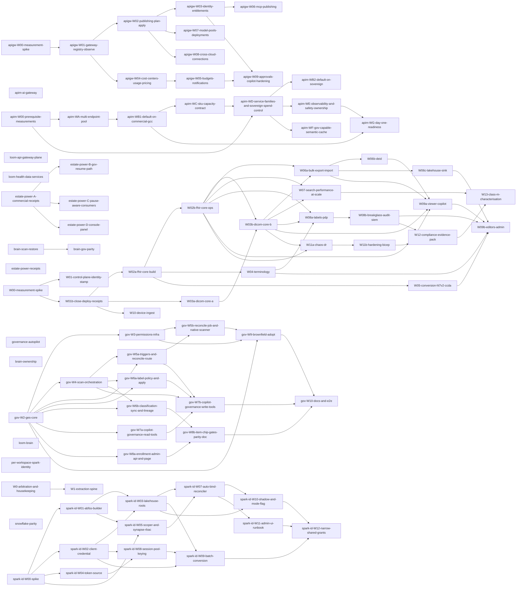

# Execution plan — 2026-11 (generated from PRP frontmatter)

Generated by `temp/gen_plan.py` over `PRPs/active` + `PRPs/backlog` on branch `docs/prp-audit-2026-11-14`. Regenerate; do not hand-edit tables.
Population: **83** PRP files with frontmatter. Shared rules: [`INTERLOCK.md`](INTERLOCK.md) (bicep slot, hot files, operator-held items).

## Rules for every wave
- WIP <= 4 lanes; one bicep-touching PR in flight (INTERLOCK section 1).
- Integration check after each wave merges: `make validate` and `python -S -E ~/.claude/kits/orchestrated-prp/prp_index.py check --root .` (both must exit 0). A narrow gate is not `make validate`.
- Merge order inside a wave: bicep PR first (it holds the slot), then console/CP code, then docs. One item at a time into the integration branch; no force-push.
- Done = deployed and verified live (`deploy-integrity.md` R2). Say "merged, not deployed" until a receipt exists; Commercial green proves nothing about Gov.
- LHDS W13 full-scale characterisation is **blocked on operator spend approval (not approved 2026-11-14)**.

## Dependency graph



## Waves (by declared wave, then order)

### Wave 0

| PRP | Status | Blocked-by | Bicep | Branch | File |
|---|---|---|---|---|---|
| `W0-arbitration-and-housekeeping` | backlog | - | yes | `docs/snowflake-w0-decisions` | [backlog/snowflake-parity/W0-arbitration-and-housekeeping.md](../backlog/snowflake-parity/W0-arbitration-and-housekeeping.md) |
| `apim-W00-prerequisite-measurements` | active | - | no | `?` | [active/apim-ai-gateway/apim-W00-prerequisite-measurements.md](../active/apim-ai-gateway/apim-W00-prerequisite-measurements.md) |

### Wave 1

| PRP | Status | Blocked-by | Bicep | Branch | File |
|---|---|---|---|---|---|
| `brain-ownership` | backlog | - | no | `?` | [backlog/loom-brain/brain-ownership.md](../backlog/loom-brain/brain-ownership.md) |
| `estate-power-A-commercial-receipts` | backlog | - | no | `?` | [backlog/estate-power-receipts/estate-power-A-commercial-receipts.md](../backlog/estate-power-receipts/estate-power-A-commercial-receipts.md) |
| `spark-id-W00-spike` | backlog | - | no | `?` | [backlog/per-workspace-spark-identity/spark-id-W00-spike.md](../backlog/per-workspace-spark-identity/spark-id-W00-spike.md) |
| `W01-control-plane-identity-stamp` | active | W00-measurement-spike | no | `?` | [active/loom-health-data-services/W01-control-plane-identity-stamp.md](../active/loom-health-data-services/W01-control-plane-identity-stamp.md) |
| `W1-extraction-spine` | backlog | W0-arbitration-and-housekeeping | yes | `feat/snowflake-w1-<item>` | [backlog/snowflake-parity/W1-extraction-spine.md](../backlog/snowflake-parity/W1-extraction-spine.md) |
| `W01b-close-deploy-receipts` | active | W00-measurement-spike | yes | `?` | [active/loom-health-data-services/W01b-close-deploy-receipts.md](../active/loom-health-data-services/W01b-close-deploy-receipts.md) |
| `brain-scan-restore` | backlog | - | no | `?` | [backlog/loom-brain/brain-scan-restore.md](../backlog/loom-brain/brain-scan-restore.md) |
| `gov-W2-ges-core` | backlog | - | no | `?` | [backlog/governance-autopilot/gov-W2-ges-core.md](../backlog/governance-autopilot/gov-W2-ges-core.md) |
| `apim-WA-multi-endpoint-pool` | active | apim-W00-prerequisite-measurements | yes | `?` | [active/apim-ai-gateway/apim-WA-multi-endpoint-pool.md](../active/apim-ai-gateway/apim-WA-multi-endpoint-pool.md) |

### Wave 2

| PRP | Status | Blocked-by | Bicep | Branch | File |
|---|---|---|---|---|---|
| `brain-gov-parity` | backlog | brain-scan-restore | yes | `?` | [backlog/loom-brain/brain-gov-parity.md](../backlog/loom-brain/brain-gov-parity.md) |
| `estate-power-B-gov-resume-path` | backlog | estate-power-A-commercial-receipts | no | `?` | [backlog/estate-power-receipts/estate-power-B-gov-resume-path.md](../backlog/estate-power-receipts/estate-power-B-gov-resume-path.md) |
| `estate-power-C-pause-aware-consumers` | backlog | estate-power-A-commercial-receipts | no | `?` | [backlog/estate-power-receipts/estate-power-C-pause-aware-consumers.md](../backlog/estate-power-receipts/estate-power-C-pause-aware-consumers.md) |
| `spark-id-W01-abfss-builder` | backlog | spark-id-W00-spike | no | `?` | [backlog/per-workspace-spark-identity/spark-id-W01-abfss-builder.md](../backlog/per-workspace-spark-identity/spark-id-W01-abfss-builder.md) |
| `W02a-fhir-core-build` | active | W01b-close-deploy-receipts | yes | `?` | [active/loom-health-data-services/W02a-fhir-core-build.md](../active/loom-health-data-services/W02a-fhir-core-build.md) |
| `W03a-dicom-core-a` | backlog | W01b-close-deploy-receipts | yes | `?` | [active/loom-health-data-services/W03a-dicom-core-a.md](../active/loom-health-data-services/W03a-dicom-core-a.md) |
| `W10-device-ingest` | backlog | W01b-close-deploy-receipts | yes | `?` | [active/loom-health-data-services/W10-device-ingest.md](../active/loom-health-data-services/W10-device-ingest.md) |
| `gov-W3-permissions-infra` | backlog | gov-W2-ges-core | yes | `?` | [backlog/governance-autopilot/gov-W3-permissions-infra.md](../backlog/governance-autopilot/gov-W3-permissions-infra.md) |
| `gov-W4-scan-orchestration` | backlog | gov-W2-ges-core | no | `?` | [backlog/governance-autopilot/gov-W4-scan-orchestration.md](../backlog/governance-autopilot/gov-W4-scan-orchestration.md) |
| `gov-W7a-copilot-governance-read-tools` | backlog | gov-W2-ges-core | no | `?` | [backlog/governance-autopilot/gov-W7a-copilot-governance-read-tools.md](../backlog/governance-autopilot/gov-W7a-copilot-governance-read-tools.md) |
| `gov-W8a-enrollment-admin-api-and-page` | backlog | gov-W2-ges-core | no | `?` | [backlog/governance-autopilot/gov-W8a-enrollment-admin-api-and-page.md](../backlog/governance-autopilot/gov-W8a-enrollment-admin-api-and-page.md) |
| `apim-WB1-default-on-commercial-gcc` | active | apim-WA-multi-endpoint-pool | yes | `?` | [active/apim-ai-gateway/apim-WB1-default-on-commercial-gcc.md](../active/apim-ai-gateway/apim-WB1-default-on-commercial-gcc.md) |

### Wave 3

| PRP | Status | Blocked-by | Bicep | Branch | File |
|---|---|---|---|---|---|
| `estate-power-D-console-panel` | backlog | estate-power-A-commercial-receipts | no | `?` | [backlog/estate-power-receipts/estate-power-D-console-panel.md](../backlog/estate-power-receipts/estate-power-D-console-panel.md) |
| `spark-id-W02-client-credential` | backlog | spark-id-W00-spike | no | `?` | [backlog/per-workspace-spark-identity/spark-id-W02-client-credential.md](../backlog/per-workspace-spark-identity/spark-id-W02-client-credential.md) |
| `spark-id-W04-token-source` | backlog | spark-id-W00-spike | yes | `?` | [backlog/per-workspace-spark-identity/spark-id-W04-token-source.md](../backlog/per-workspace-spark-identity/spark-id-W04-token-source.md) |
| `W02b-fhir-core-ops` | backlog | W02a-fhir-core-build | no | `?` | [active/loom-health-data-services/W02b-fhir-core-ops.md](../active/loom-health-data-services/W02b-fhir-core-ops.md) |
| `W03b-dicom-core-b` | backlog | W03a-dicom-core-a, W02b-fhir-core-ops | no | `?` | [active/loom-health-data-services/W03b-dicom-core-b.md](../active/loom-health-data-services/W03b-dicom-core-b.md) |
| `W04-terminology` | backlog | W02a-fhir-core-build | yes | `?` | [active/loom-health-data-services/W04-terminology.md](../active/loom-health-data-services/W04-terminology.md) |
| `W05-conversion-hl7v2-ccda` | backlog | W02a-fhir-core-build | yes | `?` | [active/loom-health-data-services/W05-conversion-hl7v2-ccda.md](../active/loom-health-data-services/W05-conversion-hl7v2-ccda.md) |
| `gov-W5a-triggers-and-reconcile-route` | backlog | gov-W2-ges-core, gov-W4-scan-orchestration | no | `?` | [backlog/governance-autopilot/gov-W5a-triggers-and-reconcile-route.md](../backlog/governance-autopilot/gov-W5a-triggers-and-reconcile-route.md) |
| `gov-W6a-label-policy-and-apply` | backlog | gov-W2-ges-core, gov-W4-scan-orchestration | no | `?` | [backlog/governance-autopilot/gov-W6a-label-policy-and-apply.md](../backlog/governance-autopilot/gov-W6a-label-policy-and-apply.md) |
| `gov-W6b-classification-sync-and-lineage` | backlog | gov-W2-ges-core, gov-W4-scan-orchestration | no | `?` | [backlog/governance-autopilot/gov-W6b-classification-sync-and-lineage.md](../backlog/governance-autopilot/gov-W6b-classification-sync-and-lineage.md) |
| `apim-WC-sku-capacity-contract` | active | apim-WB1-default-on-commercial-gcc | yes | `?` | [active/apim-ai-gateway/apim-WC-sku-capacity-contract.md](../active/apim-ai-gateway/apim-WC-sku-capacity-contract.md) |

### Wave 4

| PRP | Status | Blocked-by | Bicep | Branch | File |
|---|---|---|---|---|---|
| `spark-id-W03-lakehouse-roots` | backlog | spark-id-W01-abfss-builder, spark-id-W02-client-credential | no | `?` | [backlog/per-workspace-spark-identity/spark-id-W03-lakehouse-roots.md](../backlog/per-workspace-spark-identity/spark-id-W03-lakehouse-roots.md) |
| `spark-id-W05-scoper-and-synapse-rbac` | backlog | spark-id-W00-spike, spark-id-W01-abfss-builder | yes | `?` | [backlog/per-workspace-spark-identity/spark-id-W05-scoper-and-synapse-rbac.md](../backlog/per-workspace-spark-identity/spark-id-W05-scoper-and-synapse-rbac.md) |
| `W06a-bulk-export-import` | backlog | W02b-fhir-core-ops, W03b-dicom-core-b | no | `?` | [active/loom-health-data-services/W06a-bulk-export-import.md](../active/loom-health-data-services/W06a-bulk-export-import.md) |
| `gov-W5b-reconcile-job-and-native-scanner` | backlog | gov-W5a-triggers-and-reconcile-route, gov-W3-permissions-infra | yes | `?` | [backlog/governance-autopilot/gov-W5b-reconcile-job-and-native-scanner.md](../backlog/governance-autopilot/gov-W5b-reconcile-job-and-native-scanner.md) |
| `W07-search-performance-at-scale` | backlog | W02b-fhir-core-ops, W03b-dicom-core-b | yes | `?` | [active/loom-health-data-services/W07-search-performance-at-scale.md](../active/loom-health-data-services/W07-search-performance-at-scale.md) |
| `W08a-labels-pdp` | backlog | W02b-fhir-core-ops, W03b-dicom-core-b, W04-terminology | no | `?` | [active/loom-health-data-services/W08a-labels-pdp.md](../active/loom-health-data-services/W08a-labels-pdp.md) |
| `gov-W7b-copilot-governance-write-tools` | backlog | gov-W7a-copilot-governance-read-tools, gov-W4-scan-orchestration, gov-W5a-triggers-and-reconcile-route, gov-W6a-label-policy-and-apply | no | `?` | [backlog/governance-autopilot/gov-W7b-copilot-governance-write-tools.md](../backlog/governance-autopilot/gov-W7b-copilot-governance-write-tools.md) |
| `gov-W8b-item-chip-gates-parity-doc` | backlog | gov-W8a-enrollment-admin-api-and-page, gov-W6b-classification-sync-and-lineage | no | `?` | [backlog/governance-autopilot/gov-W8b-item-chip-gates-parity-doc.md](../backlog/governance-autopilot/gov-W8b-item-chip-gates-parity-doc.md) |
| `apim-WD-service-families-and-sovereign-spend-control` | active | apim-W00-prerequisite-measurements, apim-WC-sku-capacity-contract | yes | `?` | [active/apim-ai-gateway/apim-WD-service-families-and-sovereign-spend-control.md](../active/apim-ai-gateway/apim-WD-service-families-and-sovereign-spend-control.md) |

### Wave 5

| PRP | Status | Blocked-by | Bicep | Branch | File |
|---|---|---|---|---|---|
| `spark-id-W07-auto-bind-reconciler` | backlog | spark-id-W05-scoper-and-synapse-rbac, spark-id-W03-lakehouse-roots | no | `?` | [backlog/per-workspace-spark-identity/spark-id-W07-auto-bind-reconciler.md](../backlog/per-workspace-spark-identity/spark-id-W07-auto-bind-reconciler.md) |
| `spark-id-W08-session-pool-keying` | backlog | spark-id-W02-client-credential, spark-id-W04-token-source | no | `?` | [backlog/per-workspace-spark-identity/spark-id-W08-session-pool-keying.md](../backlog/per-workspace-spark-identity/spark-id-W08-session-pool-keying.md) |
| `W06b-deid` | backlog | W06a-bulk-export-import | yes | `?` | [active/loom-health-data-services/W06b-deid.md](../active/loom-health-data-services/W06b-deid.md) |
| `W06c-lakehouse-sink` | backlog | W06a-bulk-export-import | yes | `?` | [active/loom-health-data-services/W06c-lakehouse-sink.md](../active/loom-health-data-services/W06c-lakehouse-sink.md) |
| `W08b-breakglass-audit-siem` | backlog | W08a-labels-pdp | yes | `?` | [active/loom-health-data-services/W08b-breakglass-audit-siem.md](../active/loom-health-data-services/W08b-breakglass-audit-siem.md) |
| `gov-W9-brownfield-adopt` | backlog | gov-W2-ges-core, gov-W3-permissions-infra, gov-W5b-reconcile-job-and-native-scanner | yes | `?` | [backlog/governance-autopilot/gov-W9-brownfield-adopt.md](../backlog/governance-autopilot/gov-W9-brownfield-adopt.md) |
| `apim-WB2-default-on-sovereign` | blocked | apim-WD-service-families-and-sovereign-spend-control | yes | `?` | [active/apim-ai-gateway/apim-WB2-default-on-sovereign.md](../active/apim-ai-gateway/apim-WB2-default-on-sovereign.md) |

### Wave 6

| PRP | Status | Blocked-by | Bicep | Branch | File |
|---|---|---|---|---|---|
| `spark-id-W09-batch-conversion` | backlog | spark-id-W02-client-credential, spark-id-W03-lakehouse-roots, spark-id-W08-session-pool-keying | no | `?` | [backlog/per-workspace-spark-identity/spark-id-W09-batch-conversion.md](../backlog/per-workspace-spark-identity/spark-id-W09-batch-conversion.md) |
| `spark-id-W10-shadow-and-mode-flag` | backlog | spark-id-W03-lakehouse-roots, spark-id-W07-auto-bind-reconciler | yes | `?` | [backlog/per-workspace-spark-identity/spark-id-W10-shadow-and-mode-flag.md](../backlog/per-workspace-spark-identity/spark-id-W10-shadow-and-mode-flag.md) |
| `W09a-viewer-copilot` | backlog | W02b-fhir-core-ops, W03b-dicom-core-b, W06a-bulk-export-import, W06b-deid | no | `?` | [active/loom-health-data-services/W09a-viewer-copilot.md](../active/loom-health-data-services/W09a-viewer-copilot.md) |
| `W11a-chaos-dr` | backlog | W02b-fhir-core-ops, W03b-dicom-core-b | no | `?` | [active/loom-health-data-services/W11a-chaos-dr.md](../active/loom-health-data-services/W11a-chaos-dr.md) |
| `gov-W10-docs-and-e2e` | backlog | gov-W7b-copilot-governance-write-tools, gov-W8b-item-chip-gates-parity-doc, gov-W9-brownfield-adopt | no | `?` | [backlog/governance-autopilot/gov-W10-docs-and-e2e.md](../backlog/governance-autopilot/gov-W10-docs-and-e2e.md) |
| `apim-WE-observability-and-safety-ownership` | active | apim-WD-service-families-and-sovereign-spend-control | yes | `?` | [active/apim-ai-gateway/apim-WE-observability-and-safety-ownership.md](../active/apim-ai-gateway/apim-WE-observability-and-safety-ownership.md) |

### Wave 7

| PRP | Status | Blocked-by | Bicep | Branch | File |
|---|---|---|---|---|---|
| `spark-id-W11-admin-ui-runbook` | backlog | spark-id-W07-auto-bind-reconciler | no | `?` | [backlog/per-workspace-spark-identity/spark-id-W11-admin-ui-runbook.md](../backlog/per-workspace-spark-identity/spark-id-W11-admin-ui-runbook.md) |
| `W09b-editors-admin` | backlog | W04-terminology, W05-conversion-hl7v2-ccda, W06c-lakehouse-sink, W08b-breakglass-audit-siem, W09a-viewer-copilot | no | `?` | [active/loom-health-data-services/W09b-editors-admin.md](../active/loom-health-data-services/W09b-editors-admin.md) |
| `apim-WF-gov-capable-semantic-cache` | active | apim-WD-service-families-and-sovereign-spend-control | yes | `?` | [active/apim-ai-gateway/apim-WF-gov-capable-semantic-cache.md](../active/apim-ai-gateway/apim-WF-gov-capable-semantic-cache.md) |

### Wave 8

| PRP | Status | Blocked-by | Bicep | Branch | File |
|---|---|---|---|---|---|
| `spark-id-W12-narrow-shared-grants` | backlog | spark-id-W09-batch-conversion, spark-id-W10-shadow-and-mode-flag, spark-id-W11-admin-ui-runbook | yes | `?` | [backlog/per-workspace-spark-identity/spark-id-W12-narrow-shared-grants.md](../backlog/per-workspace-spark-identity/spark-id-W12-narrow-shared-grants.md) |
| `W11b-hardening-bicep` | backlog | W11a-chaos-dr | yes | `?` | [active/loom-health-data-services/W11b-hardening-bicep.md](../active/loom-health-data-services/W11b-hardening-bicep.md) |
| `apim-WG-day-one-readiness` | active | apim-WB1-default-on-commercial-gcc, apim-WE-observability-and-safety-ownership | no | `?` | [active/apim-ai-gateway/apim-WG-day-one-readiness.md](../active/apim-ai-gateway/apim-WG-day-one-readiness.md) |

### Wave 9

| PRP | Status | Blocked-by | Bicep | Branch | File |
|---|---|---|---|---|---|
| `W12-compliance-evidence-pack` | backlog | W11b-hardening-bicep, W08b-breakglass-audit-siem | no | `?` | [active/loom-health-data-services/W12-compliance-evidence-pack.md](../active/loom-health-data-services/W12-compliance-evidence-pack.md) |

### Wave 10

| PRP | Status | Blocked-by | Bicep | Branch | File |
|---|---|---|---|---|---|
| `W13-class-m-characterisation` | blocked | W12-compliance-evidence-pack, W07-search-performance-at-scale | yes | `?` | [active/loom-health-data-services/W13-class-m-characterisation.md](../active/loom-health-data-services/W13-class-m-characterisation.md) |

### Wave ?

| PRP | Status | Blocked-by | Bicep | Branch | File |
|---|---|---|---|---|---|
| `W00-measurement-spike` | shipped | - | ? | `?` | [active/loom-health-data-services/W00-measurement-spike.md](../active/loom-health-data-services/W00-measurement-spike.md) |
| `loom-brain` | backlog | - | ? | `?` | [backlog/loom-brain/PRP.md](../backlog/loom-brain/PRP.md) |
| `apim-ai-gateway` | active | - | yes | `?` | [active/apim-ai-gateway/PRP.md](../active/apim-ai-gateway/PRP.md) |
| `governance-autopilot` | backlog | - | yes | `?` | [backlog/governance-autopilot/PRP.md](../backlog/governance-autopilot/PRP.md) |
| `loom-api-gateway-plane` | active | - | ? | `?` | [active/loom-api-gateway-plane/PRP.md](../active/loom-api-gateway-plane/PRP.md) |
| `apigw-W00-measurement-spike` | shipped | - | ? | `?` | [active/loom-api-gateway-plane/apigw-W00-measurement-spike.md](../active/loom-api-gateway-plane/apigw-W00-measurement-spike.md) |
| `apigw-W01-gateway-registry-observe` | shipped | apigw-W00-measurement-spike | ? | `?` | [active/loom-api-gateway-plane/apigw-W01-gateway-registry-observe.md](../active/loom-api-gateway-plane/apigw-W01-gateway-registry-observe.md) |
| `apigw-W02-publishing-plan-apply` | backlog | apigw-W01-gateway-registry-observe | ? | `?` | [active/loom-api-gateway-plane/apigw-W02-publishing-plan-apply.md](../active/loom-api-gateway-plane/apigw-W02-publishing-plan-apply.md) |
| `apigw-W03-identity-entitlements` | backlog | apigw-W02-publishing-plan-apply | ? | `?` | [active/loom-api-gateway-plane/apigw-W03-identity-entitlements.md](../active/loom-api-gateway-plane/apigw-W03-identity-entitlements.md) |
| `apigw-W04-cost-centers-usage-pricing` | backlog | apigw-W01-gateway-registry-observe | ? | `?` | [active/loom-api-gateway-plane/apigw-W04-cost-centers-usage-pricing.md](../active/loom-api-gateway-plane/apigw-W04-cost-centers-usage-pricing.md) |
| `apigw-W05-budgets-notifications` | backlog | apigw-W04-cost-centers-usage-pricing | ? | `?` | [active/loom-api-gateway-plane/apigw-W05-budgets-notifications.md](../active/loom-api-gateway-plane/apigw-W05-budgets-notifications.md) |
| `apigw-W06-mcp-publishing` | backlog | apigw-W03-identity-entitlements | ? | `?` | [active/loom-api-gateway-plane/apigw-W06-mcp-publishing.md](../active/loom-api-gateway-plane/apigw-W06-mcp-publishing.md) |
| `apigw-W07-model-pools-deployments` | backlog | apigw-W02-publishing-plan-apply | ? | `?` | [active/loom-api-gateway-plane/apigw-W07-model-pools-deployments.md](../active/loom-api-gateway-plane/apigw-W07-model-pools-deployments.md) |
| `apigw-W08-cross-cloud-connections` | backlog | apigw-W02-publishing-plan-apply | ? | `?` | [active/loom-api-gateway-plane/apigw-W08-cross-cloud-connections.md](../active/loom-api-gateway-plane/apigw-W08-cross-cloud-connections.md) |
| `apigw-W09-approvals-copilot-hardening` | backlog | apigw-W03-identity-entitlements, apigw-W05-budgets-notifications | ? | `?` | [active/loom-api-gateway-plane/apigw-W09-approvals-copilot-hardening.md](../active/loom-api-gateway-plane/apigw-W09-approvals-copilot-hardening.md) |

### Wave all

| PRP | Status | Blocked-by | Bicep | Branch | File |
|---|---|---|---|---|---|
| `loom-health-data-services` | active | - | no | `?` | [active/loom-health-data-services/PRP.md](../active/loom-health-data-services/PRP.md) |

### Wave hub

| PRP | Status | Blocked-by | Bicep | Branch | File |
|---|---|---|---|---|---|
| `estate-power-receipts` | backlog | - | no | `?` | [backlog/estate-power-receipts/PRP.md](../backlog/estate-power-receipts/PRP.md) |

### Wave n

| PRP | Status | Blocked-by | Bicep | Branch | File |
|---|---|---|---|---|---|
| `snowflake-parity` | backlog | - | yes | `?` | [backlog/snowflake-parity/PRP.md](../backlog/snowflake-parity/PRP.md) |

### Wave program

| PRP | Status | Blocked-by | Bicep | Branch | File |
|---|---|---|---|---|---|
| `per-workspace-spark-identity` | backlog | - | yes | `?` | [backlog/per-workspace-spark-identity/PRP.md](../backlog/per-workspace-spark-identity/PRP.md) |

## Kickoff prompts

Each is lifted verbatim from the PRP's own `Kickoff prompt` section. Paste into a FRESH session, one PRP per session.

### apim-W00-prerequisite-measurements

```text
Read PRPs/active/apim-ai-gateway/PRP.md, REFERENCE.md (sections 3.2, 3.4, 3.5) and
PRPs/active/loom-api-gateway-plane/W0-RECEIPT.md, then PRPs/active/apim-ai-gateway/apim-W00-prerequisite-measurements.md.
Goal: write W0-RECEIPT.md in the apim-ai-gateway folder answering Wave 0 tasks 1-6; only the residual
questions (apigw W0 already covers llm-token-limit/emit-token-metric authoring on Commercial + GCC-High).
Gov = GitHub Actions only, never local az. No bicep edits. Branch feat/apim-w00 in E:/Repos/_apim-w00.
Proof of done: every receipt row has a run id/URL; prp_index.py check exits 0.
```

### apim-WA-multi-endpoint-pool

```text
Read PRPs/active/apim-ai-gateway/PRP.md, then apim-WA-multi-endpoint-pool.md and REFERENCE.md section 3.3.
Goal: make the APIM backend pool take N endpoints (Loom-provisioned + BYO param), priority-ordered; empty pool still authors nothing.
Edit only admin-plane/main.bicep (aoaiApimBackendEndpoints + module apim args), admin-plane/apim.bicep, docs/fiab/apim-ai-gateway.md.
You take the single bicep slot: check open bicep PRs first. Branch feat/apim-wa in E:/Repos/_apim-wa.
Proof: az bicep build-params on all 7 boundary params + check-bicepparam-compiled.mjs green; 3-endpoint fixture builds 3 backends.
```

### apim-WB1-default-on-commercial-gcc

```text
Read PRPs/active/apim-ai-gateway/PRP.md, apim-WB1-default-on-commercial-gcc.md and apim-WA (must be merged).
Goal: default aoaiGateway=apim and aoaiViaApim=true in commercial, commercial-full, gcc, tenant-dmlz params + loomBackends defaults; keep them separable.
Do NOT touch gcc-high/il5/dod params (WB2). Take the single bicep slot first. Branch feat/apim-wb1 in E:/Repos/_apim-wb1.
Proof: az bicep build-params x4 + check-bicepparam-compiled.mjs green; after deploy, ApiManagementGatewayLogs shows a Copilot call.
```

### apim-WB2-default-on-sovereign

```text
Read PRPs/active/apim-ai-gateway/PRP.md and apim-WB2-default-on-sovereign.md. Precondition: apim-WD merged AND deployed to GCC-High with a ceiling in the policy XML. If not, stop.
Goal: set aoaiViaApim in gcc-high, il5, dod bicepparam only (keep il5/dod in step). Single bicep slot. Branch feat/apim-wb2 in E:/Repos/_apim-wb2.
Proof: az bicep build-params x3 + check-bicepparam-compiled.mjs; GCC-High Actions run with deploy steps>0.
```

### apim-WC-sku-capacity-contract

```text
Read PRPs/active/apim-ai-gateway/PRP.md, apim-WC-sku-capacity-contract.md, REFERENCE.md sections 2.1-2.4.
Goal: thread apim capacity param main.bicep -> admin-plane main.bicep -> apim.bicep (default 1), document per-boundary SKU/capacity matching live.
No SKU value changes. Take the single bicep slot. Branch feat/apim-wc in E:/Repos/_apim-wc.
Proof: az bicep build-params x7 + check-bicepparam-compiled.mjs; az apim list capacity equals doc table.
```

### apim-WD-service-families-and-sovereign-spend-control

```text
Read PRPs/active/apim-ai-gateway/PRP.md, apim-WD-service-families-and-sovereign-spend-control.md, W0-RECEIPT.md, REFERENCE.md 3.2/3.4/3.4.1.
Goal order: (1) sovereign spend control in apim.bicep (#4460), (2) Search/DocIntel/Speech/Vision families, (3) llm-content-safety gated on contentSafetyEnabled.
Do NOT touch the LOOM_CONTENT_SAFETY_ENDPOINT expression unless the #4458 determination exists. Single bicep slot. Branch feat/apim-wd in E:/Repos/_apim-wd.
Proof: build-params x6 + policy-XML positive/negative greps; Commercial live call per family.
```

### apim-WE-observability-and-safety-ownership

```text
Read PRPs/active/apim-ai-gateway/PRP.md and apim-WE-observability-and-safety-ownership.md, REFERENCE.md 3.4/3.4.1.
Goal: llm-emit-token-metric where measured available; per-boundary content-safety verdict owner table in docs/fiab/apim-ai-gateway.md.
Single bicep slot. Branch feat/apim-we in E:/Repos/_apim-we. Proof: build-params + a customMetrics row from a live Commercial turn.
```

### apim-WF-gov-capable-semantic-cache

```text
Read PRPs/active/apim-ai-gateway/PRP.md, apim-WF-gov-capable-semantic-cache.md, REFERENCE.md 3.2 and 3.4.
Goal: RediSearch-backed per-tenant semantic cache on redisOss, policies authored in sovereign too; hit/miss receipt in a Gov boundary.
Single bicep slot. Branch feat/apim-wf in E:/Repos/_apim-wf. Proof: build-params + GCC-High Actions run showing a hit and a miss.
```

### apim-WG-day-one-readiness

```text
Read PRPs/active/apim-ai-gateway/PRP.md and apim-WG-day-one-readiness.md; docs/fiab/ux-standards.md section 9 (G1/G2).
Goal: register an APIM AI gateway readiness gate (with Fix-it) showing per-boundary state + declared gaps; write greenfield and brownfield docs; get both receipts.
No bicep edits. Branch feat/apim-wg in E:/Repos/_apim-wg.
Proof: vitest + tsc green, make validate, browser walk of /admin/readiness with screenshots.
```

### apim-ai-gateway

```text
Read PRPs/active/apim-ai-gateway/PRP.md (hub) then REFERENCE.md. Pick the first wave in the table whose Blocked-by are all merged.
Open that wave file and follow its Kickoff prompt. You take the single bicep slot: check open bicep PRs first.
Never run local az against Gov; Gov = GitHub Actions. Report "merged, not deployed" until a deploy job executed steps.
Proof for the hub: python -S -E ~/.claude/kits/orchestrated-prp/prp_index.py check --root E:/Repos/_prp-audit exits 0.
```

### loom-health-data-services

```text
You are working on the LHDS program (E:/Repos/GitHub/csa-inabox, PRPs/active/loom-health-data-services/).
Read PRP.md (this hub), then the wave file you were assigned, then the ADRs and docs it names.
Stay inside the wave file's Owns list. Fresh worktree per the file's Wave/Branch line.
Done = the wave file's Validation commands pass AND receipts per cloud; merged-not-deployed is reported in those words.
Prove with: python -S -E ~/.claude/kits/orchestrated-prp/prp_index.py check --root .
```

### W01-control-plane-identity-stamp

```text
Do not start a session on this file. Read `W01b-close-deploy-receipts.md` and run its kickoff prompt instead.
```

### W01b-close-deploy-receipts

```text
Fresh session, Sonnet. Read in order: `PRPs/active/loom-health-data-services/W01b-close-deploy-receipts.md`, then `W01-control-plane-identity-stamp.md` (execution state),
`CONTRACT-FREEZE-W2.md`, issue #5151, and `apps/loom-health-cp/src/auth/wire.ts` (which env values it requires). Work W1b-1 first in `E:/Repos/_lhds-w1b`. Do not invent env
values; derive them in bicep. Ask the operator before any `run_mode=full` (billing). Never run Gov from the workstation; use Actions. Proof of done: the Acceptance
checklist, each with a run id or response body, posted on #5151. Report merged/deployed/verified separately.
```

### W02a-fhir-core-build

```text
Fresh session, Sonnet. Read `PRPs/active/loom-health-data-services/W02a-fhir-core-build.md`, `CONTRACT-FREEZE-W2.md`, `apps/loom-health-fhir/README.md` and `apps/loom-health-pdp/README.md`. W2-1 is merged (#5290; docs PR #5292).
Start with the SBOM claim vs `build-fiab-images-acr-tasks.yml`, then W2-2 and W2-5 in parallel worktrees (max 4 lanes). Review required on W2-2 and W2-3. Every test names the value that breaks it
(assertion-design). Proof of done: the Validation block, mutation receipts RED then green, and the W01b stamp receipt for on-stamp rows. Report merged vs deployed separately.
```

### W02b-fhir-core-ops

```text
Fresh session, Sonnet. Read `PRPs/active/loom-health-data-services/W02b-fhir-core-ops.md`, `CONTRACT-FREEZE-W2.md`, `adr/ADR-007-async-write-path-outbox.md`, and the `health-tenant` provisioner/editor as the exemplar.
Do W2-4 first so W03b can start. Confirm W02a is merged and the stamp is live (W01b receipt) before any on-stamp claim. Proof of done: the Validation block plus the Playwright walk and Inferno reports. Never mark an item done on tsc + vitest alone (ux-baseline G1).
```

### W03a-dicom-core-a

```text
Fresh session, Sonnet. Read `PRPs/active/loom-health-data-services/W03a-dicom-core-a.md`, `CONTRACT-FREEZE-W2.md`, `adr/ADR-002-dicom-engine.md`, `adr/ADR-004-dicom-storage-layout.md`, and the W0-2 section of `W0-RECEIPT.md`. Reuse `scripts/measure/health/dicom-engine-*.sh`.
Review required on all three items (security defaults, irreversible layout, authorization). Proof of done: the Validation block plus the on-stamp receipt after W01b. Report merged vs deployed separately.
```

### W03b-dicom-core-b

```text
Fresh session, Sonnet. Read `PRPs/active/loom-health-data-services/W03b-dicom-core-b.md`, `CONTRACT-FREEZE-W2.md`, `W03a-dicom-core-a.md`, and `adr/ADR-007-async-write-path-outbox.md`. Confirm W03a is merged and W2-4 (relay) is merged before W3-4; W3-5..W3-8 may start now.
Append your `health-tools.ts` and item-type blocks after W02b's. Proof of done: the Validation block, the G1 walk screenshots, and load receipt tables. Never claim Gov without an Actions run id.
```

### W04-terminology

```text
Fresh session, Sonnet. Read `PRPs/active/loom-health-data-services/W04-terminology.md`, `CONTRACT-FREEZE-W2.md`, `adr/ADR-013-terminology-service.md`, and `W02a-fhir-core-build.md`. Start with W4-1 (no dependency). Never bundle licensed content.
Append to `health-tools.ts` and the gates file only after W02b's versions are merged. Proof of done: the Validation block, the G1 walk, sample parity output. Report merged vs deployed separately.
```

### W05-conversion-hl7v2-ccda

```text
Fresh session, Sonnet. Read `PRPs/active/loom-health-data-services/W05-conversion-hl7v2-ccda.md`, `CONTRACT-FREEZE-W2.md`, `adr/ADR-014-conversion-service.md`, `W02a-fhir-core-build.md`. Start W5-4 (docs) and W5-1 in parallel worktrees.
Build enrichment behind an interface with a passthrough default; do not depend on W04. Review required on W5-2 (PHI + MLLP) and W5-4 (accuracy). Proof of done: the Validation block plus the L2 flood receipt. Report merged vs deployed separately.
```

### W06a-bulk-export-import

```text
Wave W06a (LHDS bulk export/import). Repo E:/Repos/GitHub/csa-inabox, worktree E:/Repos/_lhds-w06a, branch feat/lhds-w06a-bulk-export-import.
Read first: PRPs/active/loom-health-data-services/PRP.md (section 5), this file, adr/ADR-007, adr/ADR-003, apps/loom-health-cp/src/jobs/runner.ts.
Own only the paths in Owns. No bicep. Use Opus only for the W6-1 parallel-range design pass.
Do W6-1, then W6-2/W6-5, then W6-7. Update Execution state after each PR.
Proof: cd apps/loom-health-cp && npx vitest run src/jobs ; Inferno Bulk Data kit 0 failures on the dev stamp.
Report merged-but-not-deployed in those words.
```

### W06b-deid

```text
Wave W06b (LHDS de-identification). Repo E:/Repos/GitHub/csa-inabox, worktree E:/Repos/_lhds-w06b, branch feat/lhds-w06b-deid.
Read first: PRPs/active/loom-health-data-services/PRP.md (section 5), this file, adr/ADR-015, SECURITY-AND-COMPLIANCE.md (PHI logging).
Synthetic data only. One bicep PR at a time: check PRPs/reference/INTERLOCK.md before opening the engines.bicep PR.
Do W6-3, W6-3b, W6-6a in that order.
Proof: cd apps/loom-health-cp && npx vitest run src/jobs/deid ; golden set shows 0 of 18 identifiers.
Report merged-but-not-deployed in those words.
```

### W06c-lakehouse-sink

```text
Wave W06c (LHDS lakehouse sink). Repo E:/Repos/GitHub/csa-inabox, worktree E:/Repos/_lhds-w06c, branch feat/lhds-w06c-lakehouse-sink.
Read first: PRP.md (section 5), this file, adr/ADR-016, RISKS-AND-OPEN-DECISIONS.md (Q7, section 5).
The isolation gate must block the sink until the fix is confirmed deployed. Never quote advisory details in public files.
Do W6-4, W6-4b, W6-6b; one bicep PR at a time (INTERLOCK.md).
Proof: cd apps/loom-health-cp && npx vitest run src/jobs/sink ; Part 2 resource absent from Silver.
Report merged-but-not-deployed in those words.
```

### W07-search-performance-at-scale

```text
Wave W07 (LHDS search, bulk ops, quotas, subscriptions; SMALL-SCALE ONLY). Repo E:/Repos/GitHub/csa-inabox, worktree E:/Repos/_lhds-w07, branch feat/lhds-w07-search-performance.
Read first: PRP.md (sections 5 and 7), this file, adr/ADR-008, scripts/measure/health/sandbox.sh.
Spend cap: under $4k total, one class-S stamp, delete it after the run. NO class-M, NO 1M/10M claims: that is W13 and is not approved.
Do W7-1, W7-2, then W7-3/W7-5 in parallel, then W7-4 (bicep via INTERLOCK.md).
Proof: cd apps/loom-health-cp && npx vitest run src/jobs src/routing ; W7-RECEIPT.md labelled "functional, small scale".
Report merged-but-not-deployed in those words.
```

### W08a-labels-pdp

```text
Wave W08a (LHDS labels and consent PDP v2). Repo E:/Repos/GitHub/csa-inabox, worktree E:/Repos/_lhds-w08a, branch feat/lhds-w08a-labels-pdp.
Read first: PRP.md (section 5), this file, adr/ADR-011, apps/loom-health-pdp/policies/lhds/.
Opus for the W8-2 policy design pass only. No bicep.
Do W8-1 then W8-2.
Proof: opa test apps/loom-health-pdp/policies apps/loom-health-pdp/tests -v ; consent suite green and PDP-down fails closed.
Report merged-but-not-deployed in those words.
```

### W08b-breakglass-audit-siem

```text
Wave W08b (LHDS break-glass, audit chain, SIEM). Repo E:/Repos/GitHub/csa-inabox, worktree E:/Repos/_lhds-w08b, branch feat/lhds-w08b-breakglass-audit.
Read first: PRP.md (section 5), this file, SECURITY-AND-COMPLIANCE.md audit sections, adr/ADR-011.
One bicep PR at a time (PRPs/reference/INTERLOCK.md).
Do W8-4 first, then W8-3, then W8-5.
Proof: cd apps/loom-health-cp && npx vitest run src/audit src/auth ; tampered blob fails verification.
Report merged-but-not-deployed in those words.
```

### W09a-viewer-copilot

```text
Wave W09a (LHDS imaging viewer + Copilot write tools). Repo E:/Repos/GitHub/csa-inabox, worktree E:/Repos/_lhds-w09a, branch feat/lhds-w09a-viewer-copilot.
Read first: PRP.md (section 5), this file, adr/ADR-017, docs/fiab/ux-standards.md section 7, health-tools.ts and its test.
Do W9-1 and W9-4 (different files, may run in parallel), then W9-5a.
G1 needs a real browser walk with a synthetic CT, dark and light.
Proof: cd apps/fiab-console && npx vitest run lib/copilot/__tests__/health-tools.test.ts ; Playwright CT walk.
Report merged-but-not-deployed in those words.
```

### W09b-editors-admin

```text
Wave W09b (LHDS editors A-grade + admin page). Repo E:/Repos/GitHub/csa-inabox, worktree E:/Repos/_lhds-w09b, branch feat/lhds-w09b-editors-admin.
Read first: PRP.md (section 5), this file, docs/fiab/ux-standards.md sections 7 and 9, the existing parity docs.
Do W9-3 and W9-2 (disjoint files), then W9-5b. One PR per editor group.
G1 is blocking: real browser walk, real data, dark and light, narrow width, first-open.
Proof: cd apps/fiab-console && npx vitest run lib/editors/health && pnpm uat.
Report merged-but-not-deployed in those words.
```

### W10-device-ingest

```text
Wave W10 (LHDS device ingest). Repo E:/Repos/GitHub/csa-inabox, worktree E:/Repos/_lhds-w10, branch feat/lhds-w10-device-ingest.
Read first: PRP.md (sections 2 and 5), this file, adr/ADR-018, platform/fiab/bicep/modules/health/eventing.bicep, CONTRACT-FREEZE-W2.md.
Own only apps/loom-health-device-mapper and the listed files. One bicep PR at a time (INTERLOCK.md). Synthetic devices only.
Do W10-1 first, then W10-2/W10-3, then W10-4 when W02a is deployed.
Proof: cd apps/loom-health-device-mapper && npx vitest run ; duplicate message yields no second Observation.
Report merged-but-not-deployed in those words.
```

### W11a-chaos-dr

```text
Wave W11a (LHDS chaos, restore, evacuation). Repo E:/Repos/GitHub/csa-inabox, worktree E:/Repos/_lhds-w11a, branch feat/lhds-w11a-chaos-dr.
Read first: PRP.md (section 5), this file, OPERATIONS-AND-BCDR.md sections 4-6, TEST-STRATEGY.md section 6.
Drills on synthetic tenants only; check the estate is not paused. Opus for the W11-3 design pass only.
Do W11-1, W11-2, W11-3.
Proof: gh run view <health-chaos run id> shows zero lost writes and duplicates 0.
Report merged-but-not-deployed in those words.
```

### W11b-hardening-bicep

```text
Wave W11b (LHDS failover bicep, scale-out, MPI, upgrades, SLOs). Repo E:/Repos/GitHub/csa-inabox, worktree E:/Repos/_lhds-w11b, branch feat/lhds-w11b-hardening-bicep.
Read first: PRP.md (section 5), this file, OPERATIONS-AND-BCDR.md, adr/ADR-006, W11a receipts.
One bicep PR at a time (INTERLOCK.md). Gov failover only if a second Gov region is funded; otherwise state "not drilled".
Do W11-4 first (W11-5 and W11-6 in parallel), then W11-7.
Proof: cd apps/loom-health-cp && npx vitest run src/jobs src/mpi ; failover drill run id with RPO/RTO.
Report merged-but-not-deployed in those words.
```

### W12-compliance-evidence-pack

```text
Wave W12 (LHDS compliance evidence pack). Repo E:/Repos/GitHub/csa-inabox, worktree E:/Repos/_lhds-w12, branch feat/lhds-w12-evidence-pack.
Read first: PRP.md, this file, SECURITY-AND-COMPLIANCE.md sections 15-16, W08b and W11 receipts.
Never write that the platform is certified, authorized or compliant; mapping and evidence only.
Do W12-1 and W12-2, then W12-3, then W12-4.
Proof: cd apps/loom-health-cp && npx vitest run src/evidence ; tampered input changes the pack hash.
Report merged-but-not-deployed in those words.
```

### W13-class-m-characterisation

```text
Wave W13 (LHDS class-M characterisation). BLOCKED: do not start unless the operator has approved the spend in writing and every other wave is done and verified.
If approved: repo E:/Repos/GitHub/csa-inabox, worktree E:/Repos/_lhds-w13, branch feat/lhds-w13-class-m.
Read first: this file, W07-search-performance-at-scale.md, W7-RECEIPT.md, W0-RECEIPT.md section 8.
Record the approved cap and dates in this file before provisioning. Delete the stamp at the end.
Proof: W13-RECEIPT.md has a verdict per carried bar and CAPACITY-MODEL.md section 10 rows cite it.
```

### estate-power-A-commercial-receipts

```text
Read PRPs/backlog/estate-power-receipts/PRP.md and estate-power-A-commercial-receipts.md, then .github/workflows/estate-power.yml. Run state, preview, pause, resume and one scheduled idle auto-pause on Commercial through Actions only, reading each resource back via ARM. Write docs/fiab/receipts/estate-power-commercial.md. Done = every readback cell filled and the idle receipt cites a schedule-event run.
```

### estate-power-B-gov-resume-path

```text
Read PRPs/backlog/estate-power-receipts/PRP.md and estate-power-B-gov-resume-path.md. Gov actions run via Actions only. First dispatch estate-power.yml boundary=GCC-High action=state and classify the result before anything else; if the Entra grant is missing, stop and record the blocker. Done = a GCC-High pause+resume receipt with readbacks, or a recorded blocked(owner), plus node --test green.
```

### estate-power-C-pause-aware-consumers

```text
Read PRPs/backlog/estate-power-receipts/PRP.md and estate-power-C-pause-aware-consumers.md, then .github/workflows/estate-pause-gate.yml. With the Commercial estate paused (coordinate with lane A), dispatch each consumer read-only and record job conclusion + step count; positive control first. Done = every consumer row filled and estate-standdown-wiring tests green.
```

### estate-power-D-console-panel

```text
Read PRPs/backlog/estate-power-receipts/PRP.md and estate-power-D-console-panel.md, then estate-power-panel.tsx and docs/fiab/parity/estate-power.md. Click-walk every control on the live Commercial console (coordinate the estate window with lane A), including first-open and narrow width. Done = walk record with screenshots, tsc + vitest for lib/components/admin-scaling pass, parity doc has zero missing rows.
```

### estate-power-receipts

```text
Read PRPs/backlog/estate-power-receipts/PRP.md, then estate-power-A-commercial-receipts.md and .github/workflows/estate-power.yml.
Run the Commercial Pause, Resume and a scheduled idle auto-pause through Actions only, reading every resource back via ARM, and write docs/fiab/receipts/estate-power-commercial.md.
Do not delete anything and finish with the estate in its declared state. Proof of done: every readback cell filled and the idle receipt cites a schedule-event run.
```

### gov-W10-docs-and-e2e

```text
Read PRPs/backlog/governance-autopilot/PRP.md, DESIGN.md s7/s12 and deploy-integrity.md R8; confirm every other wave is merged AND deployed. Write the two walkthroughs, the E2E spec and the Actions receipt job. Proof: mkdocs build, E2E pass, Commercial live receipt, GCC-High Actions run id.
```

### gov-W2-ges-core

```text
Read PRPs/backlog/governance-autopilot/PRP.md, DESIGN.md s5.1/5.3/5.4 and this file. Do the Opus design pass first, then implement lib/governance/enrollment/** with an injected Purview port. Proof: vitest on lib/governance + the sandbox mutation RED/green record in the PR.
```

### gov-W3-permissions-infra

```text
Read PRPs/backlog/governance-autopilot/PRP.md, DESIGN.md s5.6/s6.3, W0-RECEIPT.md s2b, and PRPs/reference/INTERLOCK.md first; stop if another bicep PR is open. Proof: az bicep build on touched modules, Actions What-If run ids for Commercial and GCC-High, governance-permissions.mjs exit code. Report merged vs deployed separately.
```

### gov-W4-scan-orchestration

```text
Read PRPs/backlog/governance-autopilot/PRP.md, DESIGN.md s5.5 and W0-RECEIPT.md s2c/s10, then implement lib/governance/enrollment/scans/**. Proof: vitest on lib/governance + lib/scheduler, paused-skip mutation RED in a sandbox copy, and (after W3 is deployed) one live scan Succeeded with asset count; otherwise say "live receipt pending W3".
```

### gov-W5a-triggers-and-reconcile-route

```text
Read PRPs/backlog/governance-autopilot/PRP.md, DESIGN.md s5.2/5.3/5.13 and this file. Add hooks (lines only) to item-crud.ts, delegate autoOnboard to GES, add the internal reconcile route with service-identity auth. Proof: vitest on app/api/items + lib/governance, then the clean-create and delete-scan-out-of-band receipts.
```

### gov-W5b-reconcile-job-and-native-scanner

```text
Read PRPs/backlog/governance-autopilot/PRP.md, DESIGN.md s5.12 and PRPs/reference/INTERLOCK.md; stop if another bicep PR is open or W3 is unmerged. Build the job module and apps/fiab-governance-scanner. Proof: az bicep build, What-If run ids, one Commercial job run with swept-count and population.
```

### gov-W6a-label-policy-and-apply

```text
Read PRPs/backlog/governance-autopilot/PRP.md, DESIGN.md s5.7 and the sensitivity-label route. Extract the apply function first (route tests unchanged), then the policy engine. Proof: vitest on the route and lib/governance, never-downgrade mutation RED in a sandbox copy.
```

### gov-W6b-classification-sync-and-lineage

```text
Read PRPs/backlog/governance-autopilot/PRP.md, DESIGN.md s5.7, then extend purview-classification-sync.ts additively and add the three lineage emitters. Proof: vitest on lib/lineage plus the idempotency test.
```

### gov-W7a-copilot-governance-read-tools

```text
Read PRPs/backlog/governance-autopilot/PRP.md, DESIGN.md s5.8, lib/governance/inventory-tool.ts (copy its pattern). Implement read tools in lib/copilot/governance-tools.ts and register them. Proof: vitest on lib/copilot including the non-admin tenant-scope denial and the 11th-call rate-limit trip.
```

### gov-W7b-copilot-governance-write-tools

```text
Read PRPs/backlog/governance-autopilot/PRP.md and DESIGN.md s5.8/s7.1; confirm W7a, W4, W5a, W6a are merged. Add write tools wrapping the existing engines with confirm + audit. Proof: vitest on lib/copilot and the live operator-prompt walk.
```

### gov-W8a-enrollment-admin-api-and-page

```text
Read PRPs/backlog/governance-autopilot/PRP.md, DESIGN.md s5.10, docs/fiab/ux-standards.md s7, and a polished sibling admin page. Build the API and page against the W2 store. Proof: vitest, pnpm uat, and a browser walk with dark/light screenshots and a narrow-width pass.
```

### gov-W8b-item-chip-gates-parity-doc

```text
Read PRPs/backlog/governance-autopilot/PRP.md, DESIGN.md s5.10, and lib/gates/registry/catalog-governance.ts. Add the chip, gate Fix-it entries and parity doc. Proof: vitest on lib/gates, parity doc with zero missing rows, browser walk screenshots.
```

### gov-W9-brownfield-adopt

```text
Read PRPs/backlog/governance-autopilot/PRP.md, DESIGN.md s5.11/s7.3 and deploy-integrity.md R5; confirm W3 and W5b are merged and no other bicep PR is open. Build discovery, preflight and Fix-it. Proof: vitest, the brownfield E2E on an existing-estate fixture, and the GCC-High Actions run id.
```

### governance-autopilot

```text
Read PRPs/backlog/governance-autopilot/PRP.md (hub), then the wave file you are assigned and the DESIGN.md sections it cites.
Check PRPs/reference/INTERLOCK.md before any bicep wave (W3, W5b, W9). Re-verify line numbers at head; DESIGN.md citations were taken at 089666884.
Proof of done is in the wave file's Validation section; report merged vs deployed vs verified separately.
```

### brain-gov-parity

```text
Read PRPs/backlog/loom-brain/PRP.md, issues #3937 and #4051, and the Gov job in loom-brain-scan.yml; confirm brain-scan-restore is merged and no other bicep PR is open. Audit endpoints, pick the runner approach, dispatch via Actions. Proof: Actions run URL with Gov node and edge counts.
```

### brain-ownership

```text
Read PRPs/backlog/loom-brain/PRP.md and issue #4255 comments. First measure the live approvable count and tag coverage (Commercial), record N of M, then build the owned/observed split and batch execute. Proof: vitest on lib/brain-actions + app/admin/brain, the live count, a browser walk with screenshots.
```

### brain-scan-restore

```text
Read PRPs/backlog/loom-brain/PRP.md, issue #4721 and the header of .github/workflows/loom-brain-scan.yml. Run gh run view --log-failed on the latest failed run, find the cause, fix it. Proof: a dispatched run whose report shows node and edge counts above zero.
```

### loom-brain

```text
Read PRPs/backlog/loom-brain/PRP.md (DoD baseline), then your child PRP and the DESIGN.md sections it cites.
Measure current live state first (approvable count, latest scan run) and record it; do not assume the baseline table is still true.
Proof of done is in the child's Validation section; report merged vs deployed vs verified separately.
```

### per-workspace-spark-identity

```text
Read PRPs/backlog/per-workspace-spark-identity/PRP.md (hub) then spark-id-W00-spike.md and REFERENCE.md sections 2.5, 2.6, 3.
Run the nine W0 measurements in a sandbox (Gov only via Actions), filling docs/fiab/spikes/spark-identity-w0.md from the receipt template.
Do not start any other wave until W00 has a b1/b2 verdict per boundary. Proof of done: the report has no empty measurement cells.
```

### spark-id-W00-spike

```text
Read PRPs/backlog/per-workspace-spark-identity/PRP.md and spark-id-W00-spike.md, then REFERENCE.md sections 2.5, 2.6, 3. Do the nine measurements in the sandbox, filling docs/fiab/spikes/spark-identity-w0.md from the receipt template. Gov boundaries only via an Actions dispatch. Proof of done: the report has zero empty measurement cells and a b1/b2 verdict per boundary.
```

### spark-id-W01-abfss-builder

```text
Read PRPs/backlog/per-workspace-spark-identity/PRP.md, spark-id-W01-abfss-builder.md, REFERENCE.md 2.3. Replace literal DFS suffixes in the six sites with resolveLakehouseAbfss/dfsSuffix and add scripts/ci/check-abfss-builder.mjs. Done = tsc + the named vitest + node --test + the ratchet exit 0, and the mutation run goes RED in a sandbox copy.
```

### spark-id-W02-client-credential

```text
Read PRPs/backlog/per-workspace-spark-identity/PRP.md, spark-id-W02-client-credential.md, REFERENCE.md 2.1-2.2. Add an optional {credential, workspace} to the Livy/batch client functions and tag all 27 call sites; add scripts/ci/check-spark-submit-identity.mjs. Done = tsc, the named vitest, node --test, and the ratchet pass; default path unchanged.
```

### spark-id-W03-lakehouse-roots

```text
Read PRPs/backlog/per-workspace-spark-identity/PRP.md, spark-id-W03-lakehouse-roots.md, REFERENCE.md 2.4. Make the six class W lakehouse routes resolve workspace+root from the item id and pass the W02 tag. Done = tsc and `pnpm exec vitest run app/api/lakehouse` pass; binding and legacy-root tests named in the PRP fail under the stated mutations.
```

### spark-id-W04-token-source

```text
Read PRPs/backlog/per-workspace-spark-identity/PRP.md, spark-id-W04-token-source.md, the W00 report, workspace-identity-client.ts. Build the submitter host and credentialFor spark branch. First claim the bicep INTERLOCK slot. Done = tsc + named vitest pass and a live oid/aud claim receipt exists per deployed boundary.
```

### spark-id-W05-scoper-and-synapse-rbac

```text
Read PRPs/backlog/per-workspace-spark-identity/PRP.md, spark-id-W05-scoper-and-synapse-rbac.md, REFERENCE.md 2.5/4(b), and the W00 report. Build SparkLakeScoper (ABAC+ACL) and the Synapse Compute Operator ensure in workspace-grants.ts. Done = tsc + the named vitest pass (trailing-slash test fails if the slash is removed) and an inside-OK/outside-403 probe receipt per deployed boundary.
```

### spark-id-W07-auto-bind-reconciler

```text
Read PRPs/backlog/per-workspace-spark-identity/PRP.md, spark-id-W07-auto-bind-reconciler.md, REFERENCE.md 6. Wire auto-bind into workspace/lakehouse lifecycle with a fingerprint reconciler. Done = tsc + named vitest pass, drift test is RED under the constant-fingerprint mutation, and a clean-create walk shows the binding with no admin step.
```

### spark-id-W08-session-pool-keying

```text
Read PRPs/backlog/per-workspace-spark-identity/PRP.md, spark-id-W08-session-pool-keying.md. Key spark-session-pool.ts by workspace. Done = tsc + vitest for the pool pass and the isolation test goes RED when the workspace is removed from the key.
```

### spark-id-W09-batch-conversion

```text
Read PRPs/backlog/per-workspace-spark-identity/PRP.md, spark-id-W09-batch-conversion.md, REFERENCE.md 2.1. Convert the batch call sites for classes U/W to per-workspace sessions behind the mode flag. Done = tsc + named vitest pass; class P batches still use submitLivyBatch; load-to-table parity row counts equal.
```

### spark-id-W10-shadow-and-mode-flag

```text
Read PRPs/backlog/per-workspace-spark-identity/PRP.md, spark-id-W10-shadow-and-mode-flag.md. Add LOOM_SPARK_IDENTITY_MODE (off/shadow/enforce) + shadow evaluator + env-check row. Claim the bicep INTERLOCK slot first. Done = tsc + named vitest pass and az bicep build is clean; no default spend.
```

### spark-id-W11-admin-ui-runbook

```text
Read PRPs/backlog/per-workspace-spark-identity/PRP.md, spark-id-W11-admin-ui-runbook.md, docs/fiab/ux-standards.md section 7. Extend workspace-identity-panel.tsx with the spark-lake binding state and Re-bind. Done = tsc + vitest for lib/panes pass and a G1 browser walk with dark/light screenshots.
```

### spark-id-W12-narrow-shared-grants

```text
Read PRPs/backlog/per-workspace-spark-identity/PRP.md, spark-id-W12-narrow-shared-grants.md, REFERENCE.md 7 phase 4. Add the two scope params (default account) and narrow only on operator approval per boundary. Claim the bicep INTERLOCK slot first. Done = az bicep build clean, what-if run link shows only intended changes, probe receipt per boundary.
```

### snowflake-parity

```text
Read PRPs/backlog/snowflake-parity/PRP.md (hub), then W0-arbitration-and-housekeeping.md. W0 is a decision record: write RECOMMENDED decisions, never record one as decided.
Do not start W1 until the operator has ratified D1-D5. Proof of done for W0: `python -S -E ~/.claude/kits/orchestrated-prp/prp_index.py check --root .` exits 0 and the decisions doc has an operator-ratified line per decision.
```

### W0-arbitration-and-housekeeping

```text
Read PRPs/backlog/snowflake-parity/PRP.md, this file, then REFERENCE-2026-08-25-full-draft.md sections 9, 7.2, 13 and 15 only.
Run W0.A first: write W0-DECISIONS.md with D1-D4, each labelled "RECOMMENDED - operator must ratify" and an empty RATIFIED line; never record anything as decided.
Re-measure each cited row against origin/main before using it. W0.B must fetch Microsoft's audit-scope pages; cite URL + date per cell.
Stop and ask the operator before W0.D touches main.bicep (bicep ledger slot).
Proof of done: prp_index.py check exits 0, grep for "SPNs cannot create CA" in platform/fiab/bicep returns 0, W0-DECISIONS.md has >= 5 RECOMMENDED labels.
```

### W1-extraction-spine

```text
Read PRPs/backlog/snowflake-parity/PRP.md, then this file, then W0-DECISIONS.md (confirm D5 is RATIFIED; if not, ask the operator and do not claim IL5).
Confirm W0.D merged (two images: loom-mcp from apps/loom-mcp, loom-azmcp) before W1.5. Re-measure every "missing" claim against origin/main first.
Run W1.2 and W1.3 in parallel worktrees; run W1.1, W1.4, W1.5 one at a time (one bicep PR in flight).
No credential in any tool, command or file. Done = vitest/npm tests for the touched package pass, bicep builds, PR open, CI green, live receipt per Acceptance; otherwise say "merged, not deployed".
```

## PRPs with no Kickoff prompt section (hub or reference files)

`apigw-W00-measurement-spike`, `apigw-W01-gateway-registry-observe`, `apigw-W02-publishing-plan-apply`, `apigw-W03-identity-entitlements`, `apigw-W04-cost-centers-usage-pricing`, `apigw-W05-budgets-notifications`, `apigw-W06-mcp-publishing`, `apigw-W07-model-pools-deployments`, `apigw-W08-cross-cloud-connections`, `apigw-W09-approvals-copilot-hardening`, `loom-api-gateway-plane`, `W00-measurement-spike`
