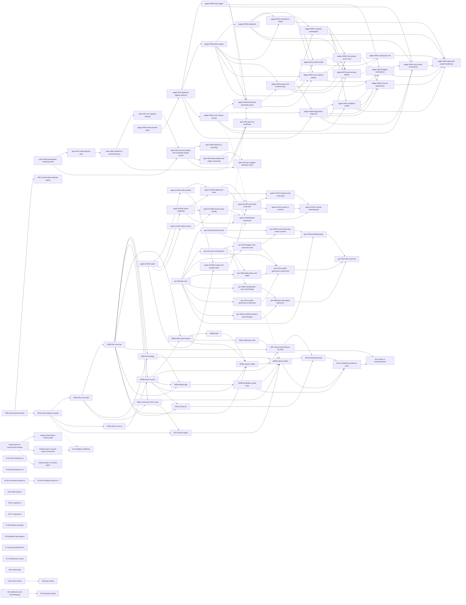

# Execution plan (generated from PRP frontmatter)

Generated by `python tools/prp/gen_plan.py`. Do not hand-edit; change the PRP and regenerate.
Population: **106** PRP files with frontmatter under `PRPs/active` and `PRPs/backlog`. Cross-program ordering and the bicep queue: [`GLOBAL-SCHEDULE.md`](GLOBAL-SCHEDULE.md). Shared rules: [`INTERLOCK.md`](INTERLOCK.md).

## Dependency graph

Solid edges are `depends_on`; dotted edges are `Cross-program order` lines.



## Per-program waves (wave numbers are local to each program)

### loom-health-data-services

| PRP | Status | Wave | Blocked-by | Bicep | Branch |
|---|---|---|---|---|---|
| [`W00-measurement-spike`](../active/loom-health-data-services/W00-measurement-spike.md) | shipped | 0 | - | - | `-` |
| [`W01-control-plane-identity-stamp`](../active/loom-health-data-services/W01-control-plane-identity-stamp.md) | active | 1 | W00-measurement-spike | no | `-` |
| [`W01b-close-deploy-receipts`](../active/loom-health-data-services/W01b-close-deploy-receipts.md) | active | 1 | W00-measurement-spike | yes | `-` |
| [`W02a-fhir-core-build`](../active/loom-health-data-services/W02a-fhir-core-build.md) | active | 2 | W01b-close-deploy-receipts | yes | `-` |
| [`W03a-dicom-core-a`](../active/loom-health-data-services/W03a-dicom-core-a.md) | backlog | 2 | W01b-close-deploy-receipts | yes | `-` |
| [`W02b-fhir-core-ops`](../active/loom-health-data-services/W02b-fhir-core-ops.md) | backlog | 3 | W02a-fhir-core-build | no | `-` |
| [`W03b-dicom-core-b`](../active/loom-health-data-services/W03b-dicom-core-b.md) | backlog | 4 | W03a-dicom-core-a, W02b-fhir-core-ops | no | `-` |
| [`W04-terminology`](../active/loom-health-data-services/W04-terminology.md) | backlog | 4 | W02a-fhir-core-build, W02b-fhir-core-ops | yes | `-` |
| [`W05-conversion-hl7v2-ccda`](../active/loom-health-data-services/W05-conversion-hl7v2-ccda.md) | backlog | 4 | W02a-fhir-core-build, W02b-fhir-core-ops | yes | `-` |
| [`W10-device-ingest`](../active/loom-health-data-services/W10-device-ingest.md) | backlog | 5 | W01b-close-deploy-receipts, W05-conversion-hl7v2-ccda | yes | `-` |
| [`W06a-bulk-export-import`](../active/loom-health-data-services/W06a-bulk-export-import.md) | backlog | 5 | W02b-fhir-core-ops, W03b-dicom-core-b | no | `-` |
| [`W07-search-performance-at-scale`](../active/loom-health-data-services/W07-search-performance-at-scale.md) | backlog | 5 | W02b-fhir-core-ops, W03b-dicom-core-b | yes | `-` |
| [`W08a-labels-pdp`](../active/loom-health-data-services/W08a-labels-pdp.md) | backlog | 5 | W02b-fhir-core-ops, W03b-dicom-core-b, W04-terminology | no | `-` |
| [`W06b-deid`](../active/loom-health-data-services/W06b-deid.md) | backlog | 6 | W06a-bulk-export-import | yes | `-` |
| [`W06c-lakehouse-sink`](../active/loom-health-data-services/W06c-lakehouse-sink.md) | backlog | 6 | W06a-bulk-export-import | yes | `-` |
| [`W08b-breakglass-audit-siem`](../active/loom-health-data-services/W08b-breakglass-audit-siem.md) | backlog | 6 | W08a-labels-pdp | yes | `-` |
| [`W11a-chaos-dr`](../active/loom-health-data-services/W11a-chaos-dr.md) | backlog | 6 | W02b-fhir-core-ops, W03b-dicom-core-b | no | `-` |
| [`W09a-viewer-copilot`](../active/loom-health-data-services/W09a-viewer-copilot.md) | backlog | 7 | W02b-fhir-core-ops, W03b-dicom-core-b, W06a-bulk-export-import, W06b-deid | no | `-` |
| [`W09b-editors-admin`](../active/loom-health-data-services/W09b-editors-admin.md) | backlog | 8 | W04-terminology, W05-conversion-hl7v2-ccda, W06c-lakehouse-sink, W08b-breakglass-audit-siem, W09a-viewer-copilot, W10-device-ingest, gov-W8a-enrollment-admin-api-and-page (cross-program) | no | `-` |
| [`W11b-hardening-bicep`](../active/loom-health-data-services/W11b-hardening-bicep.md) | backlog | 9 | W11a-chaos-dr, W09b-editors-admin, W07-search-performance-at-scale | yes | `-` |
| [`W12-compliance-evidence-pack`](../active/loom-health-data-services/W12-compliance-evidence-pack.md) | backlog | 10 | W11b-hardening-bicep, W08b-breakglass-audit-siem, W09b-editors-admin | no | `-` |
| [`W13-class-m-characterisation`](../active/loom-health-data-services/W13-class-m-characterisation.md) | blocked | 11 | W12-compliance-evidence-pack, W07-search-performance-at-scale | yes | `-` |

### loom-api-gateway-plane

| PRP | Status | Wave | Blocked-by | Bicep | Branch |
|---|---|---|---|---|---|
| [`apigw-W01b-close-gaps`](../active/loom-api-gateway-plane/apigw-W01b-close-gaps.md) | backlog | 2 | apigw-W01-gateway-registry-observe | no | `-` |
| [`apigw-W02a-plan-engine`](../active/loom-api-gateway-plane/apigw-W02a-plan-engine.md) | backlog | 2 | apigw-W01-gateway-registry-observe | no | `-` |
| [`apigw-W04a-cost-centers-pricing`](../active/loom-api-gateway-plane/apigw-W04a-cost-centers-pricing.md) | backlog | 2 | apigw-W01-gateway-registry-observe | no | `-` |
| [`apigw-W02b-endpoints`](../active/loom-api-gateway-plane/apigw-W02b-endpoints.md) | backlog | 3 | apigw-W02a-plan-engine | no | `-` |
| [`apigw-W03a-bootstrap-principals-grants`](../active/loom-api-gateway-plane/apigw-W03a-bootstrap-principals-grants.md) | backlog | 3 | apigw-W01b-close-gaps, apigw-W02a-plan-engine, apigw-W04a-cost-centers-pricing, gov-W3-permissions-infra (cross-program) | yes | `-` |
| [`apigw-W02c-workbench-adopt`](../active/loom-api-gateway-plane/apigw-W02c-workbench-adopt.md) | backlog | 4 | apigw-W02a-plan-engine, apigw-W02b-endpoints | no | `-` |
| [`apigw-W03b-governed-renderer-keys`](../active/loom-api-gateway-plane/apigw-W03b-governed-renderer-keys.md) | backlog | 4 | apigw-W03a-bootstrap-principals-grants, apigw-W02a-plan-engine | no | `-` |
| [`apigw-W07a-pools-health`](../active/loom-api-gateway-plane/apigw-W07a-pools-health.md) | backlog | 4 | apigw-W02a-plan-engine, apigw-W02b-endpoints | no | `-` |
| [`apigw-W03c-requests-marketplace`](../active/loom-api-gateway-plane/apigw-W03c-requests-marketplace.md) | backlog | 5 | apigw-W03b-governed-renderer-keys, apigw-W02c-workbench-adopt | no | `-` |
| [`apigw-W04b-diagnostics-rollup-job`](../active/loom-api-gateway-plane/apigw-W04b-diagnostics-rollup-job.md) | backlog | 5 | apigw-W01-gateway-registry-observe, apigw-W04a-cost-centers-pricing, apigw-W03b-governed-renderer-keys | yes | `-` |
| [`apigw-W06a-mcp-registry-publish`](../active/loom-api-gateway-plane/apigw-W06a-mcp-registry-publish.md) | backlog | 5 | apigw-W02a-plan-engine, apigw-W02c-workbench-adopt, apigw-W03a-bootstrap-principals-grants, apigw-W03b-governed-renderer-keys | no | `-` |
| [`apigw-W04c-analytics-verifier`](../active/loom-api-gateway-plane/apigw-W04c-analytics-verifier.md) | backlog | 6 | apigw-W04b-diagnostics-rollup-job, apigw-W04a-cost-centers-pricing, apigw-W03c-requests-marketplace | no | `-` |
| [`apigw-W06b-mcp-grants-rest-to-mcp`](../active/loom-api-gateway-plane/apigw-W06b-mcp-grants-rest-to-mcp.md) | backlog | 6 | apigw-W06a-mcp-registry-publish, apigw-W03b-governed-renderer-keys, apigw-W03c-requests-marketplace | no | `-` |
| [`apigw-W07b-pool-access-deploy`](../active/loom-api-gateway-plane/apigw-W07b-pool-access-deploy.md) | backlog | 6 | apigw-W07a-pools-health, apigw-W02b-endpoints, apigw-W03b-governed-renderer-keys, apigw-W03c-requests-marketplace, apigw-W04b-diagnostics-rollup-job | no | `-` |
| [`apigw-W05-budgets-notifications`](../active/loom-api-gateway-plane/apigw-W05-budgets-notifications.md) | backlog | 7 | apigw-W01b-close-gaps, apigw-W04b-diagnostics-rollup-job, apigw-W04c-analytics-verifier, apigw-W03b-governed-renderer-keys | no | `-` |
| [`apigw-W06c-mcp-on-behalf-docs`](../active/loom-api-gateway-plane/apigw-W06c-mcp-on-behalf-docs.md) | backlog | 7 | apigw-W06a-mcp-registry-publish, apigw-W06b-mcp-grants-rest-to-mcp, apigw-W04b-diagnostics-rollup-job, apigw-W04c-analytics-verifier | no | `-` |
| [`apigw-W07c-adopt-day-one`](../active/loom-api-gateway-plane/apigw-W07c-adopt-day-one.md) | backlog | 7 | apigw-W07a-pools-health, apigw-W07b-pool-access-deploy | yes | `-` |
| [`apigw-W08-cross-cloud-connections`](../active/loom-api-gateway-plane/apigw-W08-cross-cloud-connections.md) | backlog | 8 | apigw-W01b-close-gaps, apigw-W02b-endpoints, apigw-W04a-cost-centers-pricing, apigw-W04b-diagnostics-rollup-job, apigw-W05-budgets-notifications | yes | `-` |
| [`apigw-W09-approvals-copilot-hardening`](../active/loom-api-gateway-plane/apigw-W09-approvals-copilot-hardening.md) | backlog | 9 | apigw-W02c-workbench-adopt, apigw-W03c-requests-marketplace, apigw-W04c-analytics-verifier, apigw-W05-budgets-notifications, apigw-W06c-mcp-on-behalf-docs, apigw-W07c-adopt-day-one, apigw-W08-cross-cloud-connections | no | `-` |
| [`apigw-W00-measurement-spike`](../active/loom-api-gateway-plane/apigw-W00-measurement-spike.md) | shipped | - | - | - | `-` |
| [`apigw-W01-gateway-registry-observe`](../active/loom-api-gateway-plane/apigw-W01-gateway-registry-observe.md) | shipped | - | apigw-W00-measurement-spike | - | `-` |

### apim-ai-gateway

| PRP | Status | Wave | Blocked-by | Bicep | Branch |
|---|---|---|---|---|---|
| [`apim-W00-prerequisite-measurements`](../active/apim-ai-gateway/apim-W00-prerequisite-measurements.md) | active | 0 | - | no | `-` |
| [`apim-WA-multi-endpoint-pool`](../active/apim-ai-gateway/apim-WA-multi-endpoint-pool.md) | active | 1 | apim-W00-prerequisite-measurements | yes | `-` |
| [`apim-WB1-default-on-commercial-gcc`](../active/apim-ai-gateway/apim-WB1-default-on-commercial-gcc.md) | active | 2 | apim-WA-multi-endpoint-pool | yes | `-` |
| [`apim-WC-sku-capacity-contract`](../active/apim-ai-gateway/apim-WC-sku-capacity-contract.md) | active | 3 | apim-WB1-default-on-commercial-gcc | yes | `-` |
| [`apim-WD-service-families-and-sovereign-spend-control`](../active/apim-ai-gateway/apim-WD-service-families-and-sovereign-spend-control.md) | active | 4 | apim-W00-prerequisite-measurements, apim-WC-sku-capacity-contract | yes | `-` |
| [`apim-WB2-default-on-sovereign`](../active/apim-ai-gateway/apim-WB2-default-on-sovereign.md) | blocked | 5 | apim-WD-service-families-and-sovereign-spend-control | yes | `-` |
| [`apim-WE-observability-and-safety-ownership`](../active/apim-ai-gateway/apim-WE-observability-and-safety-ownership.md) | active | 6 | apim-WD-service-families-and-sovereign-spend-control | yes | `-` |
| [`apim-WF-gov-capable-semantic-cache`](../active/apim-ai-gateway/apim-WF-gov-capable-semantic-cache.md) | active | 7 | apim-WD-service-families-and-sovereign-spend-control, apim-WE-observability-and-safety-ownership | yes | `-` |
| [`apim-WG-day-one-readiness`](../active/apim-ai-gateway/apim-WG-day-one-readiness.md) | active | 8 | apim-WB1-default-on-commercial-gcc, apim-WE-observability-and-safety-ownership, apigw-W01b-close-gaps (cross-program) | no | `-` |

### estate-power-receipts

| PRP | Status | Wave | Blocked-by | Bicep | Branch |
|---|---|---|---|---|---|
| [`estate-power-A-commercial-receipts`](../backlog/estate-power-receipts/estate-power-A-commercial-receipts.md) | backlog | 1 | - | no | `-` |
| [`estate-power-B-gov-resume-path`](../backlog/estate-power-receipts/estate-power-B-gov-resume-path.md) | backlog | 2 | estate-power-A-commercial-receipts | no | `-` |
| [`estate-power-C-pause-aware-consumers`](../backlog/estate-power-receipts/estate-power-C-pause-aware-consumers.md) | backlog | 2 | estate-power-A-commercial-receipts | no | `-` |
| [`estate-power-D-console-panel`](../backlog/estate-power-receipts/estate-power-D-console-panel.md) | backlog | 3 | estate-power-A-commercial-receipts | no | `-` |

### governance-autopilot

| PRP | Status | Wave | Blocked-by | Bicep | Branch |
|---|---|---|---|---|---|
| [`gov-W2-ges-core`](../backlog/governance-autopilot/gov-W2-ges-core.md) | backlog | 1 | - | no | `-` |
| [`gov-W3-permissions-infra`](../backlog/governance-autopilot/gov-W3-permissions-infra.md) | backlog | 2 | gov-W2-ges-core | yes | `-` |
| [`gov-W4-scan-orchestration`](../backlog/governance-autopilot/gov-W4-scan-orchestration.md) | backlog | 2 | gov-W2-ges-core | no | `-` |
| [`gov-W7a-copilot-governance-read-tools`](../backlog/governance-autopilot/gov-W7a-copilot-governance-read-tools.md) | backlog | 2 | gov-W2-ges-core | no | `-` |
| [`gov-W8a-enrollment-admin-api-and-page`](../backlog/governance-autopilot/gov-W8a-enrollment-admin-api-and-page.md) | backlog | 2 | gov-W2-ges-core | no | `-` |
| [`gov-W5a-triggers-and-reconcile-route`](../backlog/governance-autopilot/gov-W5a-triggers-and-reconcile-route.md) | backlog | 3 | gov-W2-ges-core, gov-W4-scan-orchestration | no | `-` |
| [`gov-W6a-label-policy-and-apply`](../backlog/governance-autopilot/gov-W6a-label-policy-and-apply.md) | backlog | 3 | gov-W2-ges-core, gov-W4-scan-orchestration | no | `-` |
| [`gov-W6b-classification-sync-and-lineage`](../backlog/governance-autopilot/gov-W6b-classification-sync-and-lineage.md) | backlog | 3 | gov-W2-ges-core, gov-W4-scan-orchestration | no | `-` |
| [`gov-W5b-reconcile-job-and-native-scanner`](../backlog/governance-autopilot/gov-W5b-reconcile-job-and-native-scanner.md) | backlog | 4 | gov-W5a-triggers-and-reconcile-route, gov-W3-permissions-infra | yes | `-` |
| [`gov-W7b-copilot-governance-write-tools`](../backlog/governance-autopilot/gov-W7b-copilot-governance-write-tools.md) | backlog | 4 | gov-W7a-copilot-governance-read-tools, gov-W4-scan-orchestration, gov-W5a-triggers-and-reconcile-route, gov-W6a-label-policy-and-apply | no | `-` |
| [`gov-W8b-item-chip-gates-parity-doc`](../backlog/governance-autopilot/gov-W8b-item-chip-gates-parity-doc.md) | backlog | 4 | gov-W8a-enrollment-admin-api-and-page, gov-W6b-classification-sync-and-lineage | no | `-` |
| [`gov-W9-brownfield-adopt`](../backlog/governance-autopilot/gov-W9-brownfield-adopt.md) | backlog | 5 | gov-W2-ges-core, gov-W3-permissions-infra, gov-W5b-reconcile-job-and-native-scanner | yes | `-` |
| [`gov-W10-docs-and-e2e`](../backlog/governance-autopilot/gov-W10-docs-and-e2e.md) | backlog | 6 | gov-W7b-copilot-governance-write-tools, gov-W8b-item-chip-gates-parity-doc, gov-W9-brownfield-adopt | no | `-` |

### per-workspace-spark-identity

| PRP | Status | Wave | Blocked-by | Bicep | Branch |
|---|---|---|---|---|---|
| [`spark-id-W00-spike`](../backlog/per-workspace-spark-identity/spark-id-W00-spike.md) | backlog | 1 | - | no | `-` |
| [`spark-id-W01-abfss-builder`](../backlog/per-workspace-spark-identity/spark-id-W01-abfss-builder.md) | backlog | 2 | spark-id-W00-spike | no | `-` |
| [`spark-id-W02-client-credential`](../backlog/per-workspace-spark-identity/spark-id-W02-client-credential.md) | backlog | 3 | spark-id-W00-spike | no | `-` |
| [`spark-id-W04-token-source`](../backlog/per-workspace-spark-identity/spark-id-W04-token-source.md) | backlog | 3 | spark-id-W00-spike | yes | `-` |
| [`spark-id-W03-lakehouse-roots`](../backlog/per-workspace-spark-identity/spark-id-W03-lakehouse-roots.md) | backlog | 4 | spark-id-W01-abfss-builder, spark-id-W02-client-credential | no | `-` |
| [`spark-id-W05-scoper-and-synapse-rbac`](../backlog/per-workspace-spark-identity/spark-id-W05-scoper-and-synapse-rbac.md) | backlog | 4 | spark-id-W00-spike, spark-id-W01-abfss-builder | yes | `-` |
| [`spark-id-W07-auto-bind-reconciler`](../backlog/per-workspace-spark-identity/spark-id-W07-auto-bind-reconciler.md) | backlog | 5 | spark-id-W05-scoper-and-synapse-rbac, spark-id-W03-lakehouse-roots, apigw-W04a-cost-centers-pricing (cross-program) | no | `-` |
| [`spark-id-W08-session-pool-keying`](../backlog/per-workspace-spark-identity/spark-id-W08-session-pool-keying.md) | backlog | 5 | spark-id-W02-client-credential, spark-id-W04-token-source | no | `-` |
| [`spark-id-W09-batch-conversion`](../backlog/per-workspace-spark-identity/spark-id-W09-batch-conversion.md) | backlog | 6 | spark-id-W02-client-credential, spark-id-W03-lakehouse-roots, spark-id-W08-session-pool-keying, gov-W4-scan-orchestration (cross-program) | no | `-` |
| [`spark-id-W10-shadow-and-mode-flag`](../backlog/per-workspace-spark-identity/spark-id-W10-shadow-and-mode-flag.md) | backlog | 6 | spark-id-W03-lakehouse-roots, spark-id-W07-auto-bind-reconciler | yes | `-` |
| [`spark-id-W11-admin-ui-runbook`](../backlog/per-workspace-spark-identity/spark-id-W11-admin-ui-runbook.md) | backlog | 7 | spark-id-W07-auto-bind-reconciler | no | `-` |
| [`spark-id-W12-narrow-shared-grants`](../backlog/per-workspace-spark-identity/spark-id-W12-narrow-shared-grants.md) | backlog | 8 | spark-id-W09-batch-conversion, spark-id-W10-shadow-and-mode-flag, spark-id-W11-admin-ui-runbook | yes | `-` |

### loom-brain

| PRP | Status | Wave | Blocked-by | Bicep | Branch |
|---|---|---|---|---|---|
| [`brain-ownership`](../backlog/loom-brain/brain-ownership.md) | backlog | 1 | - | no | `-` |
| [`brain-scan-restore`](../backlog/loom-brain/brain-scan-restore.md) | backlog | 1 | - | no | `-` |
| [`brain-gov-parity`](../backlog/loom-brain/brain-gov-parity.md) | backlog | 2 | brain-scan-restore | yes | `-` |

### snowflake-parity

| PRP | Status | Wave | Blocked-by | Bicep | Branch |
|---|---|---|---|---|---|
| [`W0-arbitration-and-housekeeping`](../backlog/snowflake-parity/W0-arbitration-and-housekeeping.md) | backlog | 0 | - | yes | `docs/snowflake-w0-decisions` |
| [`W1-extraction-spine`](../backlog/snowflake-parity/W1-extraction-spine.md) | backlog | 1 | W0-arbitration-and-housekeeping | yes | `feat/snowflake-w1-<item>` |

### issue-batches

| PRP | Status | Wave | Blocked-by | Bicep | Branch |
|---|---|---|---|---|---|
| [`ib-01-brain-detectors-a`](../backlog/issue-batches/ib-01-brain-detectors-a.md) | backlog | 1 | - | no | `-` |
| [`ib-02-brain-detectors-b`](../backlog/issue-batches/ib-02-brain-detectors-b.md) | backlog | 1 | - | no | `-` |
| [`ib-03-no-freeform-pickers-a`](../backlog/issue-batches/ib-03-no-freeform-pickers-a.md) | backlog | 1 | - | no | `-` |
| [`ib-05-slate-parity-a`](../backlog/issue-batches/ib-05-slate-parity-a.md) | backlog | 1 | - | no | `-` |
| [`ib-06-ci-guards-a`](../backlog/issue-batches/ib-06-ci-guards-a.md) | backlog | 1 | - | no | `-` |
| [`ib-07-ci-guards-b`](../backlog/issue-batches/ib-07-ci-guards-b.md) | backlog | 1 | - | no | `-` |
| [`ib-08-release-eval-gate`](../backlog/issue-batches/ib-08-release-eval-gate.md) | backlog | 1 | - | no | `-` |
| [`ib-09-gitleaks-log-hygiene`](../backlog/issue-batches/ib-09-gitleaks-log-hygiene.md) | backlog | 1 | - | no | `-` |
| [`ib-10-deploy-workflows`](../backlog/issue-batches/ib-10-deploy-workflows.md) | backlog | 1 | W01b-close-deploy-receipts (cross-program), estate-power-C-pause-aware-consumers (cross-program) | no | `-` |
| [`ib-11-bicep-autobind-env`](../backlog/issue-batches/ib-11-bicep-autobind-env.md) | backlog | 1 | - | yes | `-` |
| [`ib-12-lakehouse-routes`](../backlog/issue-batches/ib-12-lakehouse-routes.md) | backlog | 1 | - | no | `-` |
| [`ib-04-no-freeform-pickers-b`](../backlog/issue-batches/ib-04-no-freeform-pickers-b.md) | backlog | 2 | ib-03-no-freeform-pickers-a | no | `-` |

## Kickoff prompts

Lifted verbatim from each PRP's own `Kickoff prompt` section. One PRP per fresh session.

### apim-W00-prerequisite-measurements

```text
Read PRPs/active/apim-ai-gateway/PRP.md, REFERENCE.md (sections 3.2, 3.4, 3.5) and
PRPs/active/loom-api-gateway-plane/W0-RECEIPT.md, then PRPs/active/apim-ai-gateway/apim-W00-prerequisite-measurements.md.
Goal: write W0-RECEIPT.md in the apim-ai-gateway folder answering Wave 0 tasks 1-6; only the residual
questions (apigw W0 already covers llm-token-limit/emit-token-metric authoring on Commercial + GCC-High).
Gov = GitHub Actions only, never local az. No bicep edits. Branch feat/apim-w00 in E:/Repos/_apim-w00.
Proof of done: every receipt row has a run id/URL; prp_index.py check exits 0.
```

### apim-WA-multi-endpoint-pool

```text
Read PRPs/active/apim-ai-gateway/PRP.md, then apim-WA-multi-endpoint-pool.md and REFERENCE.md section 3.3.
Goal: make the APIM backend pool take N endpoints (Loom-provisioned + BYO param), priority-ordered; empty pool still authors nothing.
Edit only admin-plane/main.bicep (aoaiApimBackendEndpoints + module apim args), admin-plane/apim.bicep, docs/fiab/apim-ai-gateway.md.
You take the single bicep slot: check open bicep PRs first. Branch feat/apim-wa in E:/Repos/_apim-wa.
Proof: az bicep build-params on all 7 boundary params + check-bicepparam-compiled.mjs green; 3-endpoint fixture builds 3 backends.
```

### apim-WB1-default-on-commercial-gcc

```text
Read PRPs/active/apim-ai-gateway/PRP.md, apim-WB1-default-on-commercial-gcc.md and apim-WA (must be merged).
Goal: default aoaiGateway=apim and aoaiViaApim=true in commercial, commercial-full, gcc, tenant-dmlz params + loomBackends defaults; keep them separable.
Do NOT touch gcc-high/il5/dod params (WB2). Take the single bicep slot first. Branch feat/apim-wb1 in E:/Repos/_apim-wb1.
Proof: az bicep build-params x4 + check-bicepparam-compiled.mjs green; after deploy, ApiManagementGatewayLogs shows a Copilot call.
```

### apim-WB2-default-on-sovereign

```text
Read PRPs/active/apim-ai-gateway/PRP.md and apim-WB2-default-on-sovereign.md. Precondition: apim-WD merged AND deployed to GCC-High with a ceiling in the policy XML. If not, stop.
Goal: set aoaiViaApim in gcc-high, il5, dod bicepparam only (keep il5/dod in step). Single bicep slot. Branch feat/apim-wb2 in E:/Repos/_apim-wb2.
Proof: az bicep build-params x3 + check-bicepparam-compiled.mjs; GCC-High Actions run with deploy steps>0.
```

### apim-WC-sku-capacity-contract

```text
Read PRPs/active/apim-ai-gateway/PRP.md, apim-WC-sku-capacity-contract.md, REFERENCE.md sections 2.1-2.4.
Goal: thread apim capacity param main.bicep -> admin-plane main.bicep -> apim.bicep (default 1), document per-boundary SKU/capacity matching live.
No SKU value changes. Take the single bicep slot. Branch feat/apim-wc in E:/Repos/_apim-wc.
Proof: az bicep build-params x7 + check-bicepparam-compiled.mjs; az apim list capacity equals doc table.
```

### apim-WD-service-families-and-sovereign-spend-control

```text
Read PRPs/active/apim-ai-gateway/PRP.md, apim-WD-service-families-and-sovereign-spend-control.md, W0-RECEIPT.md, REFERENCE.md 3.2/3.4/3.4.1.
Goal order: (1) sovereign spend control in apim.bicep (#4460), (2) Search/DocIntel/Speech/Vision families, (3) llm-content-safety gated on contentSafetyEnabled.
Do NOT touch the LOOM_CONTENT_SAFETY_ENDPOINT expression unless the #4458 determination exists. Single bicep slot. Branch feat/apim-wd in E:/Repos/_apim-wd.
Proof: build-params x6 + policy-XML positive/negative greps; Commercial live call per family.
```

### apim-WE-observability-and-safety-ownership

```text
Read PRPs/active/apim-ai-gateway/PRP.md and apim-WE-observability-and-safety-ownership.md, REFERENCE.md 3.4/3.4.1.
Goal: llm-emit-token-metric where measured available; per-boundary content-safety verdict owner table in docs/fiab/apim-ai-gateway.md.
Single bicep slot. Branch feat/apim-we in E:/Repos/_apim-we. Proof: build-params + a customMetrics row from a live Commercial turn.
```

### apim-WF-gov-capable-semantic-cache

```text
Read PRPs/active/apim-ai-gateway/PRP.md, apim-WF-gov-capable-semantic-cache.md, REFERENCE.md 3.2 and 3.4.
Goal: RediSearch-backed per-tenant semantic cache on redisOss, policies authored in sovereign too; hit/miss receipt in a Gov boundary.
Single bicep slot. Branch feat/apim-wf in E:/Repos/_apim-wf. Proof: build-params + GCC-High Actions run showing a hit and a miss.
```

### apim-WG-day-one-readiness

```text
Read PRPs/active/apim-ai-gateway/PRP.md and apim-WG-day-one-readiness.md; docs/fiab/ux-standards.md section 9 (G1/G2).
Goal: register an APIM AI gateway readiness gate (with Fix-it) showing per-boundary state + declared gaps; write greenfield and brownfield docs; get both receipts.
No bicep edits. Branch feat/apim-wg in E:/Repos/_apim-wg.
Proof: vitest + tsc green, make validate, browser walk of /admin/readiness with screenshots.
```

### apigw-W01b-close-gaps

```text
Read PRPs/active/loom-api-gateway-plane/apigw-W01b-close-gaps.md and the W01 Completion note.
Goal: auto-register the deploy-owned gateway, scope the remaining panes, wire gates, run the G1 walk.
Edit only Owns paths. Branch feat/apigw-w01b in E:/Repos/_apigw-w01b.
Read issues #5210 #5200 #5203 #5202 #5201 #5186 at head first.
Proof: pnpm --dir apps/fiab-console vitest run lib/api-gateway/registry lib/gates; clean-roll gateway list.
Report "merged, not deployed" until /build-marker.txt matches.
```

### apigw-W02a-plan-engine

```text
Read PRPs/active/loom-api-gateway-plane/apigw-W02a-plan-engine.md, ADR-002, ADR-003, TEST-STRATEGY.md section 1.
Goal: ship plan/apply/rollback + shapes/renderers (items W2-1, W2-2). Opus first: write the module contract and mutation table, then implement.
Edit only the files under Owns. Worktree E:/Repos/_apigw-w02a, branch feat/apigw-w02a from origin/main.
Proof: pnpm --dir apps/fiab-console vitest run lib/api-gateway/plan lib/api-gateway/shapes lib/api-gateway/policy; make validate-typescript;
mutation receipts per TEST-STRATEGY section 1 in a sandbox copy. Report merged-not-deployed.
```

### apigw-W02b-endpoints

```text
Read PRPs/active/loom-api-gateway-plane/apigw-W02b-endpoints.md and ADR-004/ADR-008.
Goal: endpoint registry + readiness + key-authenticated endpoints (W2-3, W2-4). A pasted key must never be stored, logged or read back.
Edit only files under Owns. Worktree E:/Repos/_apigw-w02b, branch feat/apigw-w02b; apigw-W02a must be merged first.
Proof: pnpm --dir apps/fiab-console vitest run lib/api-gateway/registry app/api/admin/api-gateway/endpoints; make validate-typescript; Commercial G1 receipt.
Report merged-not-deployed.
```

### apigw-W02c-workbench-adopt

```text
Read PRPs/active/loom-api-gateway-plane/apigw-W02c-workbench-adopt.md, ADR-002, TEST-STRATEGY.md sections 3-4.
Goal: publications workbench (plan/apply/smoke/unpublish), adopt existing APIs, W2 docs + receipts (W2-5..W2-7). apigw-W02a and W02b must be merged.
Edit only files under Owns. Worktree E:/Repos/_apigw-w02c, branch feat/apigw-w02c.
Proof: pnpm --dir apps/fiab-console vitest run lib/api-gateway/plan app/api/admin/api-gateway/publications; make validate-typescript; publish-probe.mjs on Commercial; Gov via Actions.
Report merged-not-deployed; G1 screenshots dark and light.
```

### apigw-W03a-bootstrap-principals-grants

```text
Read PRPs/active/loom-api-gateway-plane/apigw-W03a-bootstrap-principals-grants.md, ADR-004, ADR-005, issues #5184 and #5185.
Goal: idempotent runtime/client app registrations, principals directory, grants (W3-1..W3-3). apigw-W02a and apigw-W04a must be merged.
Edit only files under Owns; only two env vars in admin-plane main.bicep (take the bicep slot first).
Worktree E:/Repos/_apigw-w03a, branch feat/apigw-w03a.
Proof: vitest on lib/api-gateway/entitlements + principals + entitlements routes; make validate-typescript; make validate-bicep; bootstrap run twice in Actions (before/after az ad app list identical).
Report merged-not-deployed.
```

### apigw-W03b-governed-renderer-keys

```text
Read PRPs/active/loom-api-gateway-plane/apigw-W03b-governed-renderer-keys.md, ADR-005, ADR-006, TEST-STRATEGY.md section 1.
Goal: governed-access fragment + apply integration + keys (W3-4, W3-5). Opus design first, then implement.
Edit only files under Owns; integrate through the apigw-W02a step registry, not engine files.
Worktree E:/Repos/_apigw-w03b, branch feat/apigw-w03b; apigw-W03a merged first.
Proof: vitest on policy, plan, entitlements, keys routes; make validate-typescript; live Commercial matrix 200/200/401/403.
Report merged-not-deployed.
```

### apigw-W03c-requests-marketplace

```text
Read PRPs/active/loom-api-gateway-plane/apigw-W03c-requests-marketplace.md, ADR-005, TEST-STRATEGY.md sections 3-4.
Goal: access requests/approvals, marketplace access and keys UI, verifier + docs (W3-6..W3-8). apigw-W03b and apigw-W02c must be merged.
Edit only files under Owns. Worktree E:/Repos/_apigw-w03c, branch feat/apigw-w03c.
Proof: vitest on access-requests + me/api-gateway; make validate-typescript; verify-model-access.mjs Commercial + Gov via Actions; Playwright api-gateway-access.uat.ts.
Report merged-not-deployed.
```

### apigw-W04a-cost-centers-pricing

```text
Read PRPs/active/loom-api-gateway-plane/apigw-W04a-cost-centers-pricing.md, ADR-006, ADR-007.
Goal: cost centers auto-bound to workspaces via applyWorkspaceBindings, plus pricing (W4-1, W4-4). Runs in parallel with apigw-W02a.
Edit only files under Owns. Worktree E:/Repos/_apigw-w04a, branch feat/apigw-w04a.
Proof: vitest on cost-centers + pricing + routes; make validate-typescript; python scripts/csa-loom/price-seed.py --check; create a workspace on Commercial and quote its cost center.
Report merged-not-deployed.
```

### apigw-W04b-diagnostics-rollup-job

```text
Read PRPs/active/loom-api-gateway-plane/apigw-W04b-diagnostics-rollup-job.md, ADR-007, W0-RECEIPT.md.
Goal: diagnostics writer + Telemetry card + 15-minute rollup worker job (W4-2, W4-3). apigw-W04a and apigw-W03b must be merged; take the bicep slot before bicep commits.
Edit only files under Owns. Worktree E:/Repos/_apigw-w04b, branch feat/apigw-w04b.
Proof: vitest on lib/api-gateway/telemetry + internal routes; make validate-typescript; make validate-bicep; after roll, rollupState.lastSuccessAt advances on Commercial.
Report merged-not-deployed.
```

### apigw-W04c-analytics-verifier

```text
Read PRPs/active/loom-api-gateway-plane/apigw-W04c-analytics-verifier.md, ADR-007, TEST-STRATEGY.md sections 3-4.
Goal: Analytics, chargeback sections, user Usage & cost, telemetry probe + docs (W4-5, W4-6). apigw-W04b, W04a, W03c merged first.
Edit only files under Owns. Worktree E:/Repos/_apigw-w04c, branch feat/apigw-w04c.
Proof: vitest on analytics + usage routes; make validate-typescript; telemetry-probe.mjs Commercial + Gov via Actions; Playwright api-gateway-analytics.uat.ts.
Report merged-not-deployed.
```

### apigw-W05-budgets-notifications

```text
Read PRPs/active/loom-api-gateway-plane/apigw-W05-budgets-notifications.md, ADR-006, OPERATOR-DECISIONS-2026-10-28.md (Q11, Q12, D12), TEST-STRATEGY.md section 1.
Goal: budgets with gateway block-list enforcement, notification engine, email/Teams channels (W5-1..W5-5). apigw-W04b, W04c, W03b merged first.
Edit only files under Owns. Worktree E:/Repos/_apigw-w05, branch feat/apigw-w05.
Proof: vitest on budgets + notify + routes; make validate-typescript; budget-probe.mjs Commercial (403 r=budget) + Gov via Actions; Playwright api-gateway-budgets.uat.ts.
Report merged-not-deployed; every email/Teams claim needs a provider acceptance id.
```

### apigw-W06a-mcp-registry-publish

```text
Read PRPs/active/loom-api-gateway-plane/apigw-W06a-mcp-registry-publish.md, PRP.md wave table, W0-RECEIPT.md section 3.
Goal: W6-1 MCP endpoint registry + discovery, then W6-2 MCP publication plan/apply (fail-closed, RFC 9728 PRM).
Edit only the Owns paths; apim-client.ts only after W02a has merged.
Branch feat/apigw-w06a in E:/Repos/_apigw-w06a (from origin/main).
Proof: pnpm --dir apps/fiab-console vitest run lib/api-gateway/mcp; the ssrf mutation goes RED in a sandbox copy.
Report "merged, not deployed" until the roll is verified.
```

### apigw-W06b-mcp-grants-rest-to-mcp

```text
Read PRPs/active/loom-api-gateway-plane/apigw-W06b-mcp-grants-rest-to-mcp.md and apigw-W06a (Provides).
Goal: W6-3 MCP grants + marketplace + verify-mcp-access.mjs; W6-5 Loom agents publish-mcp + REST-to-MCP.
Edit Owns paths; grants.ts and app/marketplace only after W03b/W03c merged.
Branch feat/apigw-w06b in E:/Repos/_apigw-w06b.
Proof: pnpm --dir apps/fiab-console vitest run lib/api-gateway/mcp lib/api-gateway/entitlements.
Report "merged, not deployed" until rolled.
```

### apigw-W06c-mcp-on-behalf-docs

```text
Read PRPs/active/loom-api-gateway-plane/apigw-W06c-mcp-on-behalf-docs.md and the apigw-W04b rollup contract.
Goal: W6-4 model caller + on-behalf join; W6-6 docs, parity rows, G1 walk.
Edit Owns paths; shared telemetry/policy files only after their owners merged.
Branch feat/apigw-w06c in E:/Repos/_apigw-w06c.
Proof: vitest run lib/api-gateway/mcp lib/api-gateway/telemetry; the late-join test goes RED when the window is widened.
"merged, not deployed" until rolled.
```

### apigw-W07a-pools-health

```text
Read PRPs/active/loom-api-gateway-plane/apigw-W07a-pools-health.md, apigw-W02a/W02b Provides.
Goal: W7-1 pools (renderer, plan/apply, workbench) then W7-2 health/suggestions + pool-probe.mjs.
Edit Owns paths only; apim-client.ts after W02a merged.
Branch feat/apigw-w07a in E:/Repos/_apigw-w07a.
Proof: vitest run lib/api-gateway/pools; mutation: drop the Retry-After keep in a sandbox copy, test RED.
"merged, not deployed" until rolled.
```

### apigw-W07b-pool-access-deploy

```text
Read PRPs/active/loom-api-gateway-plane/apigw-W07b-pool-access-deploy.md, W07a, W03b/W03c Provides.
Goal: W7-3 pool access + member pricing; W7-4 reviewed model deployment.
Edit Owns paths; shared files only per Integration step after owners merged.
Branch feat/apigw-w07b in E:/Repos/_apigw-w07b.
Proof: vitest run lib/api-gateway/deployments lib/api-gateway/entitlements.
"merged, not deployed" until rolled.
```

### apigw-W07c-adopt-day-one

```text
Read PRPs/active/loom-api-gateway-plane/apigw-W07c-adopt-day-one.md and apim-WA / apim-WB1 in PRPs/active/apim-ai-gateway.
Goal: W7-5 reviewed adoption + bicep plane mode (one bicep PR); W7-6 docs and receipts.
You take the bicep slot: check PRPs/reference/GLOBAL-SCHEDULE.md and open bicep PRs first.
Branch feat/apigw-w07c in E:/Repos/_apigw-w07c.
Proof: build-params on all 7 boundaries + check-bicepparam-compiled.mjs; adopt refuses on digest mismatch.
"merged, not deployed" until rolled.
```

### apigw-W08-cross-cloud-connections

```text
Read PRPs/active/loom-api-gateway-plane/apigw-W08-cross-cloud-connections.md, ARCHITECTURE.md ADR-009, W0-RECEIPT.md.
Goal: W8-1 vault infra (bicep slot) then W8-2 connections, W8-3 Gov via connection, W8-4 probe workflow.
Edit Owns paths only; shared files per Integration step.
Branch feat/apigw-w08 in E:/Repos/_apigw-w08. Check the bicep slot first.
Proof: build-params on 7 boundaries + vitest run lib/api-gateway/connections; flag-off route enumeration is 404.
"merged, not deployed" until rolled.
```

### apigw-W09-approvals-copilot-hardening

```text
Read PRPs/active/loom-api-gateway-plane/apigw-W09-approvals-copilot-hardening.md, PRP.md sections 7 and 9.
Goal: W9-1..W9-4 then W9-5 closure (docs, parity zero missing, receipts).
Start W9-5 only when W06c, W07c, W08 have merged and rolled.
Branch feat/apigw-w09 in E:/Repos/_apigw-w09.
Proof: make validate; vitest run lib/api-gateway lib/copilot; the parity-doc count script exits 0.
"merged, not deployed" until rolled.
```

### W01-control-plane-identity-stamp

```text
Do not start a session on this file. Read `W01b-close-deploy-receipts.md` and run its kickoff prompt instead.
```

### W01b-close-deploy-receipts

```text
Fresh session, Sonnet. Read in order: `PRPs/active/loom-health-data-services/W01b-close-deploy-receipts.md`, then `W01-control-plane-identity-stamp.md` (execution state),
`CONTRACT-FREEZE-W2.md`, issue #5151, and `apps/loom-health-cp/src/auth/wire.ts` (which env values it requires). Work W1b-1 first in `E:/Repos/_lhds-w1b`. Do not invent env
values; derive them in bicep. Ask the operator before any `run_mode=full` (billing). Never run Gov from the workstation; use Actions. Proof of done: the Acceptance
checklist, each with a run id or response body, posted on #5151. Report merged/deployed/verified separately.
```

### W02a-fhir-core-build

```text
Fresh session, Sonnet. Read `PRPs/active/loom-health-data-services/W02a-fhir-core-build.md`, `CONTRACT-FREEZE-W2.md`, `apps/loom-health-fhir/README.md` and `apps/loom-health-pdp/README.md`. W2-1 is merged (#5290; docs PR #5292).
Start with the SBOM claim vs `build-fiab-images-acr-tasks.yml`, then W2-2 and W2-5 in parallel worktrees (max 4 lanes). Review required on W2-2 and W2-3. Every test names the value that breaks it
(assertion-design). Proof of done: the Validation block, mutation receipts RED then green, and the W01b stamp receipt for on-stamp rows. Report merged vs deployed separately.
```

### W02b-fhir-core-ops

```text
Fresh session, Sonnet. Read `PRPs/active/loom-health-data-services/W02b-fhir-core-ops.md`, `CONTRACT-FREEZE-W2.md`, `adr/ADR-007-async-write-path-outbox.md`, and the `health-tenant` provisioner/editor as the exemplar.
Do W2-4 first so W03b can start. Confirm W02a is merged and the stamp is live (W01b receipt) before any on-stamp claim. Proof of done: the Validation block plus the Playwright walk and Inferno reports. Never mark an item done on tsc + vitest alone (ux-baseline G1).
```

### W03a-dicom-core-a

```text
Fresh session, Sonnet. Read `PRPs/active/loom-health-data-services/W03a-dicom-core-a.md`, `CONTRACT-FREEZE-W2.md`, `adr/ADR-002-dicom-engine.md`, `adr/ADR-004-dicom-storage-layout.md`, and the W0-2 section of `W0-RECEIPT.md`. Reuse `scripts/measure/health/dicom-engine-*.sh`.
Review required on all three items (security defaults, irreversible layout, authorization). Proof of done: the Validation block plus the on-stamp receipt after W01b. Report merged vs deployed separately.
```

### W03b-dicom-core-b

```text
Fresh session, Sonnet. Read `PRPs/active/loom-health-data-services/W03b-dicom-core-b.md`, `CONTRACT-FREEZE-W2.md`, `W03a-dicom-core-a.md`, and `adr/ADR-007-async-write-path-outbox.md`. Confirm W03a is merged and W2-4 (relay) is merged before W3-4; W3-5..W3-8 may start now.
Append your `health-tools.ts` and item-type blocks after W02b's. Proof of done: the Validation block, the G1 walk screenshots, and load receipt tables. Never claim Gov without an Actions run id.
```

### W04-terminology

```text
Fresh session, Sonnet. Read `PRPs/active/loom-health-data-services/W04-terminology.md`, `CONTRACT-FREEZE-W2.md`, `adr/ADR-013-terminology-service.md`, and `W02a-fhir-core-build.md`. Start with W4-1 (no dependency). Never bundle licensed content.
Append to `health-tools.ts` and the gates file only after W02b's versions are merged. Proof of done: the Validation block, the G1 walk, sample parity output. Report merged vs deployed separately.
```

### W05-conversion-hl7v2-ccda

```text
Fresh session, Sonnet. Read `PRPs/active/loom-health-data-services/W05-conversion-hl7v2-ccda.md`, `CONTRACT-FREEZE-W2.md`, `adr/ADR-014-conversion-service.md`, `W02a-fhir-core-build.md`. Start W5-4 (docs) and W5-1 in parallel worktrees.
Build enrichment behind an interface with a passthrough default; do not depend on W04. Review required on W5-2 (PHI + MLLP) and W5-4 (accuracy). Proof of done: the Validation block plus the L2 flood receipt. Report merged vs deployed separately.
```

### W06a-bulk-export-import

```text
Wave W06a (LHDS bulk export/import). Repo E:/Repos/GitHub/csa-inabox, worktree E:/Repos/_lhds-w06a, branch feat/lhds-w06a-bulk-export-import.
Read first: PRPs/active/loom-health-data-services/PRP.md (section 5), this file, adr/ADR-007, adr/ADR-003, apps/loom-health-cp/src/jobs/runner.ts.
Own only the paths in Owns. No bicep. Use Opus only for the W6-1 parallel-range design pass.
Do W6-1, then W6-2/W6-5, then W6-7. Update Execution state after each PR.
Proof: cd apps/loom-health-cp && npx vitest run src/jobs ; Inferno Bulk Data kit 0 failures on the dev stamp.
Report merged-but-not-deployed in those words.
```

### W06b-deid

```text
Wave W06b (LHDS de-identification). Repo E:/Repos/GitHub/csa-inabox, worktree E:/Repos/_lhds-w06b, branch feat/lhds-w06b-deid.
Read first: PRPs/active/loom-health-data-services/PRP.md (section 5), this file, adr/ADR-015, SECURITY-AND-COMPLIANCE.md (PHI logging).
Synthetic data only. One bicep PR at a time: check PRPs/reference/INTERLOCK.md before opening the engines.bicep PR.
Do W6-3, W6-3b, W6-6a in that order.
Proof: cd apps/loom-health-cp && npx vitest run src/jobs/deid ; golden set shows 0 of 18 identifiers.
Report merged-but-not-deployed in those words.
```

### W06c-lakehouse-sink

```text
Wave W06c (LHDS lakehouse sink). Repo E:/Repos/GitHub/csa-inabox, worktree E:/Repos/_lhds-w06c, branch feat/lhds-w06c-lakehouse-sink.
Read first: PRP.md (section 5), this file, adr/ADR-016, RISKS-AND-OPEN-DECISIONS.md (Q7, section 5).
The isolation gate must block the sink until the fix is confirmed deployed. Never quote advisory details in public files.
Do W6-4, W6-4b, W6-6b; one bicep PR at a time (INTERLOCK.md).
Proof: cd apps/loom-health-cp && npx vitest run src/jobs/sink ; Part 2 resource absent from Silver.
Report merged-but-not-deployed in those words.
```

### W07-search-performance-at-scale

```text
Wave W07 (LHDS search, bulk ops, quotas, subscriptions; SMALL-SCALE ONLY). Repo E:/Repos/GitHub/csa-inabox, worktree E:/Repos/_lhds-w07, branch feat/lhds-w07-search-performance.
Read first: PRP.md (sections 5 and 7), this file, adr/ADR-008, scripts/measure/health/sandbox.sh.
Spend cap: under $4k total, one class-S stamp, delete it after the run. NO class-M, NO 1M/10M claims: that is W13 and is not approved.
Do W7-1, W7-2, then W7-3/W7-5 in parallel, then W7-4 (bicep via INTERLOCK.md).
Proof: cd apps/loom-health-cp && npx vitest run src/jobs src/routing ; W7-RECEIPT.md labelled "functional, small scale".
Report merged-but-not-deployed in those words.
```

### W08a-labels-pdp

```text
Wave W08a (LHDS labels and consent PDP v2). Repo E:/Repos/GitHub/csa-inabox, worktree E:/Repos/_lhds-w08a, branch feat/lhds-w08a-labels-pdp.
Read first: PRP.md (section 5), this file, adr/ADR-011, apps/loom-health-pdp/policies/lhds/.
Opus for the W8-2 policy design pass only. No bicep.
Do W8-1 then W8-2.
Proof: opa test apps/loom-health-pdp/policies apps/loom-health-pdp/tests -v ; consent suite green and PDP-down fails closed.
Report merged-but-not-deployed in those words.
```

### W08b-breakglass-audit-siem

```text
Wave W08b (LHDS break-glass, audit chain, SIEM). Repo E:/Repos/GitHub/csa-inabox, worktree E:/Repos/_lhds-w08b, branch feat/lhds-w08b-breakglass-audit.
Read first: PRP.md (section 5), this file, SECURITY-AND-COMPLIANCE.md audit sections, adr/ADR-011.
One bicep PR at a time (PRPs/reference/INTERLOCK.md).
Do W8-4 first, then W8-3, then W8-5.
Proof: cd apps/loom-health-cp && npx vitest run src/audit src/auth ; tampered blob fails verification.
Report merged-but-not-deployed in those words.
```

### W09a-viewer-copilot

```text
Wave W09a (LHDS imaging viewer + Copilot write tools). Repo E:/Repos/GitHub/csa-inabox, worktree E:/Repos/_lhds-w09a, branch feat/lhds-w09a-viewer-copilot.
Read first: PRP.md (section 5), this file, adr/ADR-017, docs/fiab/ux-standards.md section 7, health-tools.ts and its test.
Do W9-1 and W9-4 (different files, may run in parallel), then W9-5a.
G1 needs a real browser walk with a synthetic CT, dark and light.
Proof: cd apps/fiab-console && npx vitest run lib/copilot/__tests__/health-tools.test.ts ; Playwright CT walk.
Report merged-but-not-deployed in those words.
```

### W09b-editors-admin

```text
Wave W09b (LHDS editors A-grade + admin page). Repo E:/Repos/GitHub/csa-inabox, worktree E:/Repos/_lhds-w09b, branch feat/lhds-w09b-editors-admin.
Read first: PRP.md (section 5), this file, docs/fiab/ux-standards.md sections 7 and 9, the existing parity docs.
Do W9-3 and W9-2 (disjoint files), then W9-5b. One PR per editor group.
G1 is blocking: real browser walk, real data, dark and light, narrow width, first-open.
Proof: cd apps/fiab-console && npx vitest run lib/editors/health && pnpm uat.
Report merged-but-not-deployed in those words.
```

### W10-device-ingest

```text
Wave W10 (LHDS device ingest). Repo E:/Repos/GitHub/csa-inabox, worktree E:/Repos/_lhds-w10, branch feat/lhds-w10-device-ingest.
Read first: PRP.md (sections 2 and 5), this file, adr/ADR-018, platform/fiab/bicep/modules/health/eventing.bicep, CONTRACT-FREEZE-W2.md.
Own only apps/loom-health-device-mapper and the listed files. One bicep PR at a time (INTERLOCK.md). Synthetic devices only.
Do W10-1 first, then W10-2/W10-3, then W10-4 when W02a is deployed.
Proof: cd apps/loom-health-device-mapper && npx vitest run ; duplicate message yields no second Observation.
Report merged-but-not-deployed in those words.
```

### W11a-chaos-dr

```text
Wave W11a (LHDS chaos, restore, evacuation). Repo E:/Repos/GitHub/csa-inabox, worktree E:/Repos/_lhds-w11a, branch feat/lhds-w11a-chaos-dr.
Read first: PRP.md (section 5), this file, OPERATIONS-AND-BCDR.md sections 4-6, TEST-STRATEGY.md section 6.
Drills on synthetic tenants only; check the estate is not paused. Opus for the W11-3 design pass only.
Do W11-1, W11-2, W11-3.
Proof: gh run view <health-chaos run id> shows zero lost writes and duplicates 0.
Report merged-but-not-deployed in those words.
```

### W11b-hardening-bicep

```text
Wave W11b (LHDS failover bicep, scale-out, MPI, upgrades, SLOs). Repo E:/Repos/GitHub/csa-inabox, worktree E:/Repos/_lhds-w11b, branch feat/lhds-w11b-hardening-bicep.
Read first: PRP.md (section 5), this file, OPERATIONS-AND-BCDR.md, adr/ADR-006, W11a receipts.
One bicep PR at a time (INTERLOCK.md). Gov failover only if a second Gov region is funded; otherwise state "not drilled".
Do W11-4 first (W11-5 and W11-6 in parallel), then W11-7.
Proof: cd apps/loom-health-cp && npx vitest run src/jobs src/mpi ; failover drill run id with RPO/RTO.
Report merged-but-not-deployed in those words.
```

### W12-compliance-evidence-pack

```text
Wave W12 (LHDS compliance evidence pack). Repo E:/Repos/GitHub/csa-inabox, worktree E:/Repos/_lhds-w12, branch feat/lhds-w12-evidence-pack.
Read first: PRP.md, this file, SECURITY-AND-COMPLIANCE.md sections 15-16, W08b and W11 receipts.
Never write that the platform is certified, authorized or compliant; mapping and evidence only.
Do W12-1 and W12-2, then W12-3, then W12-4.
Proof: cd apps/loom-health-cp && npx vitest run src/evidence ; tampered input changes the pack hash.
Report merged-but-not-deployed in those words.
```

### W13-class-m-characterisation

```text
Wave W13 (LHDS class-M characterisation). BLOCKED: do not start unless the operator has approved the spend in writing and every other wave is done and verified.
If approved: repo E:/Repos/GitHub/csa-inabox, worktree E:/Repos/_lhds-w13, branch feat/lhds-w13-class-m.
Read first: this file, W07-search-performance-at-scale.md, W7-RECEIPT.md, W0-RECEIPT.md section 8.
Record the approved cap and dates in this file before provisioning. Delete the stamp at the end.
Proof: W13-RECEIPT.md has a verdict per carried bar and CAPACITY-MODEL.md section 10 rows cite it.
```

### estate-power-A-commercial-receipts

```text
Read PRPs/backlog/estate-power-receipts/PRP.md and estate-power-A-commercial-receipts.md, then .github/workflows/estate-power.yml. Run state, preview, pause, resume and one scheduled idle auto-pause on Commercial through Actions only, reading each resource back via ARM. Write docs/fiab/receipts/estate-power-commercial.md. Done = every readback cell filled and the idle receipt cites a schedule-event run.
```

### estate-power-B-gov-resume-path

```text
Read PRPs/backlog/estate-power-receipts/PRP.md and estate-power-B-gov-resume-path.md. Gov actions run via Actions only. First dispatch estate-power.yml boundary=GCC-High action=state and classify the result before anything else; if the Entra grant is missing, stop and record the blocker. Done = a GCC-High pause+resume receipt with readbacks, or a recorded blocked(owner), plus node --test green.
```

### estate-power-C-pause-aware-consumers

```text
Read PRPs/backlog/estate-power-receipts/PRP.md and estate-power-C-pause-aware-consumers.md, then .github/workflows/estate-pause-gate.yml. With the Commercial estate paused (coordinate with lane A), dispatch each consumer read-only and record job conclusion + step count; positive control first. Done = every consumer row filled and estate-standdown-wiring tests green.
```

### estate-power-D-console-panel

```text
Read PRPs/backlog/estate-power-receipts/PRP.md and estate-power-D-console-panel.md, then estate-power-panel.tsx and docs/fiab/parity/estate-power.md. Click-walk every control on the live Commercial console (coordinate the estate window with lane A), including first-open and narrow width. Done = walk record with screenshots, tsc + vitest for lib/components/admin-scaling pass, parity doc has zero missing rows.
```

### gov-W10-docs-and-e2e

```text
Read PRPs/backlog/governance-autopilot/PRP.md, DESIGN.md s7/s12 and deploy-integrity.md R8; confirm every other wave is merged AND deployed. Write the two walkthroughs, the E2E spec and the Actions receipt job. Proof: mkdocs build, E2E pass, Commercial live receipt, GCC-High Actions run id.
```

### gov-W2-ges-core

```text
Read PRPs/backlog/governance-autopilot/PRP.md, DESIGN.md s5.1/5.3/5.4 and this file. Do the Opus design pass first, then implement lib/governance/enrollment/** with an injected Purview port. Proof: vitest on lib/governance + the sandbox mutation RED/green record in the PR.
```

### gov-W3-permissions-infra

```text
Read PRPs/backlog/governance-autopilot/PRP.md, DESIGN.md s5.6/s6.3, W0-RECEIPT.md s2b, and PRPs/reference/INTERLOCK.md first; stop if another bicep PR is open. Proof: az bicep build on touched modules, Actions What-If run ids for Commercial and GCC-High, governance-permissions.mjs exit code. Report merged vs deployed separately.
```

### gov-W4-scan-orchestration

```text
Read PRPs/backlog/governance-autopilot/PRP.md, DESIGN.md s5.5 and W0-RECEIPT.md s2c/s10, then implement lib/governance/enrollment/scans/**. Proof: vitest on lib/governance + lib/scheduler, paused-skip mutation RED in a sandbox copy, and (after W3 is deployed) one live scan Succeeded with asset count; otherwise say "live receipt pending W3".
```

### gov-W5a-triggers-and-reconcile-route

```text
Read PRPs/backlog/governance-autopilot/PRP.md, DESIGN.md s5.2/5.3/5.13 and this file. Add hooks (lines only) to item-crud.ts, delegate autoOnboard to GES, add the internal reconcile route with service-identity auth. Proof: vitest on app/api/items + lib/governance, then the clean-create and delete-scan-out-of-band receipts.
```

### gov-W5b-reconcile-job-and-native-scanner

```text
Read PRPs/backlog/governance-autopilot/PRP.md, DESIGN.md s5.12 and PRPs/reference/INTERLOCK.md; stop if another bicep PR is open or W3 is unmerged. Build the job module and apps/fiab-governance-scanner. Proof: az bicep build, What-If run ids, one Commercial job run with swept-count and population.
```

### gov-W6a-label-policy-and-apply

```text
Read PRPs/backlog/governance-autopilot/PRP.md, DESIGN.md s5.7 and the sensitivity-label route. Extract the apply function first (route tests unchanged), then the policy engine. Proof: vitest on the route and lib/governance, never-downgrade mutation RED in a sandbox copy.
```

### gov-W6b-classification-sync-and-lineage

```text
Read PRPs/backlog/governance-autopilot/PRP.md, DESIGN.md s5.7, then extend purview-classification-sync.ts additively and add the three lineage emitters. Proof: vitest on lib/lineage plus the idempotency test.
```

### gov-W7a-copilot-governance-read-tools

```text
Read PRPs/backlog/governance-autopilot/PRP.md, DESIGN.md s5.8, lib/governance/inventory-tool.ts (copy its pattern). Implement read tools in lib/copilot/governance-tools.ts and register them. Proof: vitest on lib/copilot including the non-admin tenant-scope denial and the 11th-call rate-limit trip.
```

### gov-W7b-copilot-governance-write-tools

```text
Read PRPs/backlog/governance-autopilot/PRP.md and DESIGN.md s5.8/s7.1; confirm W7a, W4, W5a, W6a are merged. Add write tools wrapping the existing engines with confirm + audit. Proof: vitest on lib/copilot and the live operator-prompt walk.
```

### gov-W8a-enrollment-admin-api-and-page

```text
Read PRPs/backlog/governance-autopilot/PRP.md, DESIGN.md s5.10, docs/fiab/ux-standards.md s7, and a polished sibling admin page. Build the API and page against the W2 store. Proof: vitest, pnpm uat, and a browser walk with dark/light screenshots and a narrow-width pass.
```

### gov-W8b-item-chip-gates-parity-doc

```text
Read PRPs/backlog/governance-autopilot/PRP.md, DESIGN.md s5.10, and lib/gates/registry/catalog-governance.ts. Add the chip, gate Fix-it entries and parity doc. Proof: vitest on lib/gates, parity doc with zero missing rows, browser walk screenshots.
```

### gov-W9-brownfield-adopt

```text
Read PRPs/backlog/governance-autopilot/PRP.md, DESIGN.md s5.11/s7.3 and deploy-integrity.md R5; confirm W3 and W5b are merged and no other bicep PR is open. Build discovery, preflight and Fix-it. Proof: vitest, the brownfield E2E on an existing-estate fixture, and the GCC-High Actions run id.
```

### ib-01-brain-detectors-a

```text
Read PRPs/backlog/issue-batches/ib-01-brain-detectors-a.md and .claude/rules/assertion-design.md. Work in a fresh worktree E:/Repos/_ib-01 on branch fix/ib-01-brain-detectors-a. For each of the five issues, run its named mutation on a sandbox copy first and record RED or GREEN; only add assertions or fix source where a mutation survives. Never touch scripts/brain, security-graph.json or lib/brain/run. Proof of done: `pnpm --dir apps/fiab-console vitest run lib/brain` plus the run-arms.mjs output, with the RC table in the PR body. Do not close issues; the operator closes after deploy verification.
```

### ib-02-brain-detectors-b

```text
Read PRPs/backlog/issue-batches/ib-02-brain-detectors-b.md, scripts/brain/extract-security-graph.mjs and docs/fiab/brain/security-graph-extraction.md. Worktree E:/Repos/_ib-02, branch fix/ib-02-brain-detectors-b. Run `node scripts/brain/extract-security-graph.mjs --check` first and record the result. Do #4411 and #4806 with RED-first fixtures proven on a sandbox copy, then the three prose fixes, then regenerate security-graph.json once at the end. Do not touch lib/brain/{graph,detectors,agents,history} or lib/brain/run. Proof of done: the three validation commands in section 11 all exit 0; open the PR for review (review: required).
```

### ib-03-no-freeform-pickers-a

```text
Read PRPs/backlog/issue-batches/ib-03-no-freeform-pickers-a.md, scripts/ci/check-no-freeform.mjs (TOUCH_EXEMPT) and .claude/rules/auto-bind-by-default.md. Worktree E:/Repos/_ib-03, branch fix/ib-03-no-freeform-pickers-a. Save `node scripts/ci/check-no-freeform.mjs --report` to temp/ first. Do #4389, then #4444, then #4816; each must delete its TOUCH_EXEMPT entry and lower the baseline. Never edit keyvault-secret-picker.tsx or the gate registry; ask if you need to. Proof of done: check-no-freeform.mjs exits 0, the vitest command in section 11 is green, and a live browser walk per surface is attached. Open the PR with review required.
```

### ib-04-no-freeform-pickers-b

```text
Read PRPs/backlog/issue-batches/ib-04-no-freeform-pickers-b.md and .claude/rules/assertion-design.md. Confirm ib-03-no-freeform-pickers-a is merged (rebase if so; stop and say so if not). Worktree E:/Repos/_ib-04, branch fix/ib-04-no-freeform-pickers-b. Do #4039 first with sandbox-copy mutations, then #4854, then #3626. Never put a real credential in code, tests or logs. Proof of done: check-no-freeform.mjs exits 0, the section 11 vitest command is green, and each mutation shows RED then green. Open the PR with review required.
```

### ib-05-slate-parity-a

```text
Read PRPs/backlog/issue-batches/ib-05-slate-parity-a.md, docs/fiab/parity/slate-app.md and .claude/rules/ux-baseline.md. Worktree E:/Repos/_ib-05, branch fix/ib-05-slate-parity-a. Start with #4374 (text interpolation, with a spec that fails on the literal), then extract new widgets into lib/editors/slate/widgets/ and do #4360, #4362, #4929, #4368 in that order. No mock data, no Fabric or Power BI. Proof of done: `pnpm --dir apps/fiab-console vitest run lib/editors/slate` green, `make validate-typescript`, and a browser receipt per widget kind with screenshots.
```

### ib-06-ci-guards-a

```text
Read PRPs/backlog/issue-batches/ib-06-ci-guards-a.md and .claude/rules/assertion-design.md. Worktree E:/Repos/_ib-06, branch fix/ib-06-ci-guards-a. For every issue write the failing test first and prove RED on the current code, then fix and prove green; run mutation arms only on a sandbox copy under temp/. Do not edit any workflow or settings file. Proof of done: the validation commands in section 11 all exit 0, and the PR body lists, per issue, the input that turns the test red.
```

### ib-07-ci-guards-b

```text
Read PRPs/backlog/issue-batches/ib-07-ci-guards-b.md and .claude/rules/assertion-design.md. Work in a fresh worktree E:/Repos/_ib-07 on branch fix/ib-07-ci-guards-b. For each of #4802, #4800, #4836, #4928, #3961 write the failing fixture first and run it against the unfixed guard on a sandbox copy before changing the guard. Do not touch check-tid-boundary-chokepoint.mjs or any workflow file. Baselines may only decrease. Proof of done: the node --test command in the Validation section with a higher executed count than 191, both guard scripts rc 0, and the per-issue RED/GREEN table in the PR body. Do not close issues; the operator closes after the console roll is verified.
```

### ib-08-release-eval-gate

```text
Read PRPs/backlog/issue-batches/ib-08-release-eval-gate.md and .claude/rules/assertion-design.md. Work in a fresh worktree E:/Repos/_ib-08 on branch fix/ib-08-release-eval-gate. Start with #4277: run the nonexistent-artifact mutation on a sandbox copy and record RED or GREEN. Then #4376, #3857, #3846, #4386, #4637, writing the failing test before each fix. Never edit release-please.yml, CHANGELOG.md or full-app-deploy-commercial.yml, and never dispatch a workflow. Proof of done: the node --test, vitest and pytest commands in the Validation section with their executed counts, plus the per-issue RED/GREEN table in the PR body. Do not close issues; the operator closes after a main-branch eval run shows the new delta_status.
```

### ib-09-gitleaks-log-hygiene

```text
Read PRPs/backlog/issue-batches/ib-09-gitleaks-log-hygiene.md and .claude/rules/assertion-design.md. Work in a fresh worktree E:/Repos/_ib-09 on branch fix/ib-09-gitleaks-log-hygiene. Never put a credential-shaped literal in a file, command or PR body; build every fixture at runtime. Start with #4525: write the anchoring test, watch it go RED on the 19 entries, anchor them one at a time re-running gitleaks after each. Then #4508 (measure first), #4515, #4392, #4505. Do not touch validate.yml or check-log-injection.mjs. Proof of done: the node --test command and the before/after gitleaks finding counts with the binary version, plus the negative-control table in the PR body. Request one reviewer pass; do not close issues.
```

### ib-10-deploy-workflows

```text
Read PRPs/backlog/issue-batches/ib-10-deploy-workflows.md, .claude/rules/deploy-integrity.md and .claude/rules/assertion-design.md. Work in a fresh worktree E:/Repos/_ib-10 on branch fix/ib-10-deploy-workflows. Build the pure decision scripts and their failing tests first (new files only), then make the thin workflow edits as the last commit after checking open PRs on loom-dataplane-roll.yml and build-fiab-images-acr-tasks.yml. Never edit the matrix rows, acr-firewall-lease.sh, any IL5/GCC-High/Gov workflow, or bicep, and never dispatch a workflow. Proof of done: the node --test command in the Validation section with executed counts, then report "merged, not deployed" until the operator's dispatch receipts are read. One reviewer pass; do not close issues.
```

### ib-11-bicep-autobind-env

```text
Read PRPs/backlog/issue-batches/ib-11-bicep-autobind-env.md, .claude/rules/auto-bind-by-default.md and .claude/rules/deploy-integrity.md. First take the single bicep slot (check open bicep PRs). Work in a fresh worktree E:/Repos/_ib-11 on branch fix/ib-11-bicep-autobind-env. Measure the compiled template size at the base ref, then do #4900, #3372, #4387 in that order, each with a failing test or compile assertion first. Do not edit any bicepparam, compute modules, cost-export, health or apim files. Proof of done: az bicep build for main.bicep and all five boundary params, the pytest and check-bicep-sync runs, and the before/after size. Report "merged, not deployed" until the console env shows both variables on the estate. One reviewer pass; do not close issues.
```

### ib-12-lakehouse-routes

```text
Read PRPs/backlog/issue-batches/ib-12-lakehouse-routes.md, .claude/rules/ux-baseline.md and .claude/rules/deploy-integrity.md. Work in a fresh worktree E:/Repos/_ib-12 on branch fix/ib-12-lakehouse-routes. Do #4620 (spec first, stay under the 1200-line cap), then #4862, then #5079 route by route, running check-route-toolkit.mjs and check-arm-counted-fetch.mjs after each. Authorization behaviour and response envelopes must not change; if the codemod cannot do a route safely, leave it exempt with a reason. Do not touch app/api/lakehouse, app/api/onelake, lib/azure/lakehouse-abfss.ts or any file outside the Owns list. Proof of done: the vitest and guard commands in the Validation section, baselines with deletions only, and after a roll the G1 browser walk. One reviewer pass; do not close issues.
```

### brain-gov-parity

```text
Read PRPs/backlog/loom-brain/PRP.md, issues #3937 and #4051, and the Gov job in loom-brain-scan.yml; confirm brain-scan-restore is merged and no other bicep PR is open. Audit endpoints, pick the runner approach, dispatch via Actions. Proof: Actions run URL with Gov node and edge counts.
```

### brain-ownership

```text
Read PRPs/backlog/loom-brain/PRP.md and issue #4255 comments. First measure the live approvable count and tag coverage (Commercial), record N of M, then build the owned/observed split and batch execute. Proof: vitest on lib/brain-actions + app/admin/brain, the live count, a browser walk with screenshots.
```

### brain-scan-restore

```text
Read PRPs/backlog/loom-brain/PRP.md, issue #4721 and the header of .github/workflows/loom-brain-scan.yml. Run gh run view --log-failed on the latest failed run, find the cause, fix it. Proof: a dispatched run whose report shows node and edge counts above zero.
```

### spark-id-W00-spike

```text
Read PRPs/backlog/per-workspace-spark-identity/PRP.md and spark-id-W00-spike.md, then REFERENCE.md sections 2.5, 2.6, 3. Do the nine measurements in the sandbox, filling docs/fiab/spikes/spark-identity-w0.md from the receipt template. Gov boundaries only via an Actions dispatch. Proof of done: the report has zero empty measurement cells and a b1/b2 verdict per boundary.
```

### spark-id-W01-abfss-builder

```text
Read PRPs/backlog/per-workspace-spark-identity/PRP.md, spark-id-W01-abfss-builder.md, REFERENCE.md 2.3. Replace literal DFS suffixes in the six sites with resolveLakehouseAbfss/dfsSuffix and add scripts/ci/check-abfss-builder.mjs. Done = tsc + the named vitest + node --test + the ratchet exit 0, and the mutation run goes RED in a sandbox copy.
```

### spark-id-W02-client-credential

```text
Read PRPs/backlog/per-workspace-spark-identity/PRP.md, spark-id-W02-client-credential.md, REFERENCE.md 2.1-2.2. Add an optional {credential, workspace} to the Livy/batch client functions and tag all 27 call sites; add scripts/ci/check-spark-submit-identity.mjs. Done = tsc, the named vitest, node --test, and the ratchet pass; default path unchanged.
```

### spark-id-W03-lakehouse-roots

```text
Read PRPs/backlog/per-workspace-spark-identity/PRP.md, spark-id-W03-lakehouse-roots.md, REFERENCE.md 2.4. Make the six class W lakehouse routes resolve workspace+root from the item id and pass the W02 tag. Done = tsc and `pnpm exec vitest run app/api/lakehouse` pass; binding and legacy-root tests named in the PRP fail under the stated mutations.
```

### spark-id-W04-token-source

```text
Read PRPs/backlog/per-workspace-spark-identity/PRP.md, spark-id-W04-token-source.md, the W00 report, workspace-identity-client.ts. Build the submitter host and credentialFor spark branch. First claim the bicep INTERLOCK slot. Done = tsc + named vitest pass and a live oid/aud claim receipt exists per deployed boundary.
```

### spark-id-W05-scoper-and-synapse-rbac

```text
Read PRPs/backlog/per-workspace-spark-identity/PRP.md, spark-id-W05-scoper-and-synapse-rbac.md, REFERENCE.md 2.5/4(b), and the W00 report. Build SparkLakeScoper (ABAC+ACL) and the Synapse Compute Operator ensure in workspace-grants.ts. Done = tsc + the named vitest pass (trailing-slash test fails if the slash is removed) and an inside-OK/outside-403 probe receipt per deployed boundary.
```

### spark-id-W07-auto-bind-reconciler

```text
Read PRPs/backlog/per-workspace-spark-identity/PRP.md, spark-id-W07-auto-bind-reconciler.md, REFERENCE.md 6. Wire auto-bind into workspace/lakehouse lifecycle with a fingerprint reconciler. Done = tsc + named vitest pass, drift test is RED under the constant-fingerprint mutation, and a clean-create walk shows the binding with no admin step.
```

### spark-id-W08-session-pool-keying

```text
Read PRPs/backlog/per-workspace-spark-identity/PRP.md, spark-id-W08-session-pool-keying.md. Key spark-session-pool.ts by workspace. Done = tsc + vitest for the pool pass and the isolation test goes RED when the workspace is removed from the key.
```

### spark-id-W09-batch-conversion

```text
Read PRPs/backlog/per-workspace-spark-identity/PRP.md, spark-id-W09-batch-conversion.md, REFERENCE.md 2.1. Convert the batch call sites for classes U/W to per-workspace sessions behind the mode flag. Done = tsc + named vitest pass; class P batches still use submitLivyBatch; load-to-table parity row counts equal.
```

### spark-id-W10-shadow-and-mode-flag

```text
Read PRPs/backlog/per-workspace-spark-identity/PRP.md, spark-id-W10-shadow-and-mode-flag.md. Add LOOM_SPARK_IDENTITY_MODE (off/shadow/enforce) + shadow evaluator + env-check row. Claim the bicep INTERLOCK slot first. Done = tsc + named vitest pass and az bicep build is clean; no default spend.
```

### spark-id-W11-admin-ui-runbook

```text
Read PRPs/backlog/per-workspace-spark-identity/PRP.md, spark-id-W11-admin-ui-runbook.md, docs/fiab/ux-standards.md section 7. Extend workspace-identity-panel.tsx with the spark-lake binding state and Re-bind. Done = tsc + vitest for lib/panes pass and a G1 browser walk with dark/light screenshots.
```

### spark-id-W12-narrow-shared-grants

```text
Read PRPs/backlog/per-workspace-spark-identity/PRP.md, spark-id-W12-narrow-shared-grants.md, REFERENCE.md 7 phase 4. Add the two scope params (default account) and narrow only on operator approval per boundary. Claim the bicep INTERLOCK slot first. Done = az bicep build clean, what-if run link shows only intended changes, probe receipt per boundary.
```

### W0-arbitration-and-housekeeping

```text
Read PRPs/backlog/snowflake-parity/PRP.md, this file, then REFERENCE-2026-08-25-full-draft.md sections 9, 7.2, 13 and 15 only.
Run W0.A first: write W0-DECISIONS.md with D1-D4, each labelled "RECOMMENDED - operator must ratify" and an empty RATIFIED line; never record anything as decided.
Re-measure each cited row against origin/main before using it. W0.B must fetch Microsoft's audit-scope pages; cite URL + date per cell.
Stop and ask the operator before W0.D touches main.bicep (bicep ledger slot).
Proof of done: prp_index.py check exits 0, grep for "SPNs cannot create CA" in platform/fiab/bicep returns 0, W0-DECISIONS.md has >= 5 RECOMMENDED labels.
```

### W1-extraction-spine

```text
Read PRPs/backlog/snowflake-parity/PRP.md, then this file, then W0-DECISIONS.md (confirm D5 is RATIFIED; if not, ask the operator and do not claim IL5).
Confirm W0.D merged (two images: loom-mcp from apps/loom-mcp, loom-azmcp) before W1.5. Re-measure every "missing" claim against origin/main first.
Run W1.2 and W1.3 in parallel worktrees; run W1.1, W1.4, W1.5 one at a time (one bicep PR in flight).
No credential in any tool, command or file. Done = vitest/npm tests for the touched package pass, bicep builds, PR open, CI green, live receipt per Acceptance; otherwise say "merged, not deployed".
```

## PRPs with no Kickoff prompt section

`apigw-W00-measurement-spike`, `apigw-W01-gateway-registry-observe`, `W00-measurement-spike`
